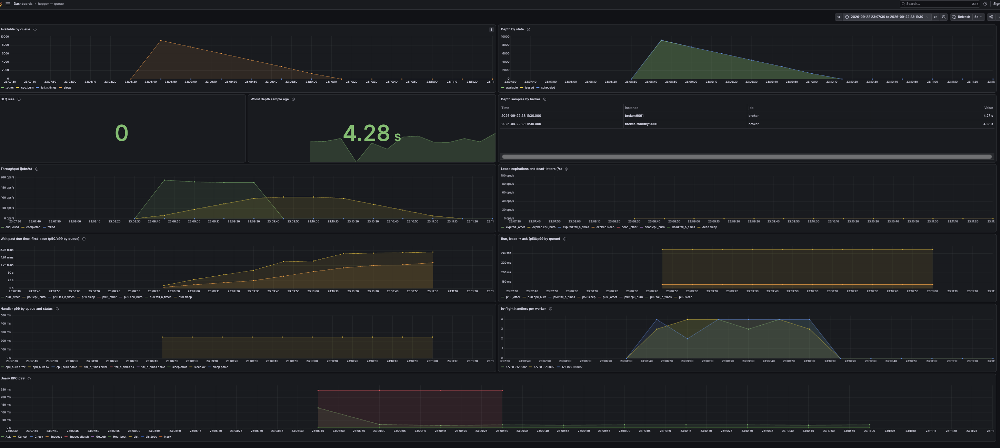

# hopper

Hopper is an at-least-once PostgreSQL job queue with a gRPC broker, a Go worker
SDK, and bounded streaming flow control. PostgreSQL owns durable state and lease
transitions; stateless brokers can be replicated without moving job ownership
into process memory.

The current Session 8 build includes the broker, producer client, worker SDK,
example worker, bulk enqueue and smoke-check CLI, a leader-elected cron
scheduler inside the broker, Prometheus metrics with a provisioned Grafana
dashboard, structured job logs that join broker and worker on `lease_id`, a
local Compose stack, and a Helm chart (with rendered plain manifests) that runs
on a local kind cluster. Image publishing, KEDA, chaos automation, and load
testing remain later-session work.

## Quick start

Requirements: Docker with Compose v2. Everything is published on loopback
only: the broker on `127.0.0.1:9090`, its metrics on `127.0.0.1:9091`,
Prometheus on `127.0.0.1:9095`, and Grafana on
[`127.0.0.1:3000`](http://127.0.0.1:3000), which opens the queue dashboard with
no login. PostgreSQL and the workers' metrics are not published to the host.

```bash
docker compose -p hopper-session7 up -d --build --scale worker=3

go run ./cmd/hopperctl enqueue \
  -queue sleep \
  -payload '{"ms":50}' \
  -n 1000 \
  -batch 100 \
  -key-prefix quickstart

# One job end to end: exits 0 once a worker completes it.
go run ./cmd/hopperctl smoke

docker compose -p hopper-session7 logs -f broker worker
docker compose -p hopper-session7 down -v
```

To watch a 10k-job burst drain on the dashboard, start the stack with the
scheduler off, so cron ticks stay out of the `sleep` queue, and use a fresh key
prefix, so a rerun is not deduplicated against the last one:

```bash
HOPPER_SCHEDULER=false docker compose -p hopper-session7 up -d --build --scale worker=3
go run ./cmd/hopperctl enqueue -queue sleep -payload '{"ms":100}' \
  -n 10000 -batch 500 -key-prefix "burst-$(date +%s)"
```

With three workers at concurrency 4 this drains in about 95 seconds.

The example worker registers three queues:

- `sleep` and `cpu_burn` accept `{"ms":100}`; omitted `ms` defaults to 100.
- `fail_n_times` accepts `{"fail":2}` and fails while `Job.Attempt <= fail`.

## Cron schedules

Schedules are declared in a JSON file passed as `-cron-file`
(`HOPPER_CRON_FILE`). The Compose stack mounts
[deploy/cron/schedules.json](deploy/cron/schedules.json) into both brokers:

```json
{
  "schedules": [
    {
      "name": "cpu-burn-5m",
      "queue": "cpu_burn",
      "cron": "*/5 * * * *",
      "timezone": "America/New_York",
      "payload": {"ms": 200},
      "priority": 5,
      "max_attempts": 3
    }
  ]
}
```

`cron` accepts a five-field expression, a descriptor such as `@hourly`, or
`@every <duration>` (one-second floor). `timezone` is an IANA name and defaults
to UTC; `payload` defaults to `{}`; `enabled` defaults to `true`. Unknown
fields, duplicate names, bad expressions, and an empty `schedules` array are
rejected at startup, so a bad file stops the broker before it listens.

Every broker contends for one PostgreSQL advisory lock, and only the holder
runs the scheduler; if it dies, its session ends, the lock is released, and
another broker takes over on its next `-scheduler-interval`. Each tick is
enqueued with the idempotency key `<name>@<tick>` and then advanced with a
compare-and-swap, so a stalled former leader cannot double-fire or rewind a
schedule.

A schedule that is overdue — after downtime or a slow failover — fires once
for its pending tick and then skips to the next future occurrence; history is
not backfilled. The leader applies the file at the start of each term: it is
authoritative, so schedules absent from it are deleted. Without a file, the
broker serves whatever rows `cron_schedules` already holds and prunes nothing.
Schedules are file-managed only; there is no management RPC yet.

Changing a schedule's `queue` starts a new delivery lineage, because
idempotency keys deduplicate within a queue; change it between ticks, not
while one is in flight.

| Flag | Environment | Default | Meaning |
|---|---|---:|---|
| `-cron-file` | `HOPPER_CRON_FILE` | empty | Schedule declarations; empty leaves `cron_schedules` unmanaged. |
| `-scheduler` | `HOPPER_SCHEDULER` | `true` | Contend for the scheduler role in this process. |
| `-scheduler-interval` | `HOPPER_SCHEDULER_INTERVAL` | `5s` | Tick period, and how often a non-leader retries the lock. |

To watch failover locally, find the leader with
`docker compose -p hopper-session7 logs broker broker-standby | grep "term won"`,
then `docker compose -p hopper-session7 stop <service>` (or `docker kill` its
container for the ungraceful path). The other broker logs `scheduler term won`
within an interval. `broker-standby` publishes no port and workers dial
`broker`, so if you stop `broker`, start it again to let workers drain the jobs
the standby fires.

See [docs/semantics.md §13](docs/semantics.md) for the full contract, including
the two windows in which a tick can fire twice.

## Worker SDK

Register handlers during setup, then call `Run` once. Handler contexts survive
the first shutdown signal so accepted work can drain, but are cancelled on
definitive lease loss, job cancellation, local lease expiry, or the forced
shutdown deadline.

```go
package main

import (
    "context"
    "errors"
    "log"
    "os/signal"
    "syscall"
    "time"

    "github.com/rpasco787/hopper/worker"
)

func main() {
    ctx, stop := signal.NotifyContext(context.Background(), syscall.SIGTERM, syscall.SIGINT)
    defer stop()

    w := worker.New("127.0.0.1:9090", worker.Options{
        ID:              "email-worker-1",
        Concurrency:     8,
        ShutdownTimeout: 30 * time.Second,
    })
    w.Handle("send_email", func(ctx context.Context, job worker.Job) error {
        var payload struct {
            To string `json:"to"`
        }
        if err := job.Unmarshal(&payload); err != nil {
            return err
        }
        // Make the external effect idempotent with job.ID (or a stable business
        // ID), and stop promptly when ctx is cancelled.
        return sendEmailOnce(ctx, job.ID.String(), payload.To)
    })

    if err := w.Run(ctx); err != nil {
        if errors.Is(err, worker.ErrAbandoned) {
            log.Printf("shutdown abandoned work: %v", err)
        }
        log.Fatal(err)
    }
}
```

Each valid delivery spends one initial Heartbeat RPC to prove that its lease is
still owned before user code starts. The SDK then renews at one third of the
broker-granted duration, and every Heartbeat pins that original grant rather
than consulting a possibly changed broker default. A capacity token remains
occupied through validation, handler execution, and Ack/Nack confirmation.

## Bulk enqueue CLI

`hopperctl enqueue` validates the entire command before dialing and sends one
bounded batch at a time:

| Flag | Default | Meaning |
|---|---:|---|
| `-broker` | `127.0.0.1:9090` | Broker address; `HOPPER_BROKER` is used when the flag is absent. |
| `-queue` | required | Destination queue. |
| `-payload` | `{}` | JSON payload shared by every generated job. |
| `-n` | `1` | Total jobs to enqueue. |
| `-batch` | `100` | Jobs per RPC, from 1 through 1,000. |
| `-priority` | `0` | Signed 16-bit priority. |
| `-max-attempts` | `0` | Retry limit; zero selects the broker default. |
| `-key-prefix` | empty | Stable keys `<prefix>-<index>`. |
| `-timeout` | `1m` | One deadline for the whole command. |

An RPC failure can be ambiguous: writes may have committed even when no response
arrived, including `RESOURCE_EXHAUSTED` on an oversized response. Do not blindly
resend an unkeyed batch. With a stable prefix, rerun the same command and the
same indexed keys deduplicate while the original rows still exist; use a smaller
batch for future attempts if message size was the problem.

`hopperctl smoke` enqueues one job (default queue `sleep`, payload
`{"ms":10}`) and polls `GetJob` every `-poll` (250ms) until it completes. It
exits 0 on `completed`, and nonzero on `dead`, `cancelled`, any error other than
`UNAVAILABLE` (which it rides out, so a broker restart is tolerated), or no
completion within `-timeout` (1m). Each run is a new unkeyed job. It is the
check behind the Helm chart's `helm test`.

## Shutdown and failure boundaries

On `SIGTERM` or `SIGINT`, `cmd/worker` stops accepting work and uses one
configured deadline for stream teardown, handlers, and confirmations. It exits
zero only after a clean drain. If the deadline passes with active delivery work,
it logs separate delivery/handler/acquisition/confirmation counts, cancels SDK
work, and exits nonzero; unconfirmed leases follow the normal reaper and retry
policy. A Go context cannot forcibly stop handler code that ignores cancellation.

Confirmation retries are deliberately narrow. The SDK retries only transient
`UNAVAILABLE` and `DEADLINE_EXCEEDED` failures while its conservative local
lease deadline remains live. Generic `INTERNAL` errors are not retried blindly:
a database mutation may already have committed, or the failure may be permanent.
This means Hopper tolerates broker restarts and selected transient transport
failures, but Session 5 does not promise transparent recovery from every
PostgreSQL outage. Handlers must remain idempotent because side effects can
duplicate across the Ack-loss window.

For the complete ownership, retry, cancellation, and trust model, see
[docs/semantics.md](docs/semantics.md).

## Observability

Brokers and workers serve Prometheus metrics on a separate HTTP listener,
`GET /metrics` only.

| Broker metric | Meaning |
|---|---|
| `hopper_queue_depth{queue,state}` | Jobs `scheduled`, `available`, `leased` and `dead`, sampled every 5s |
| `hopper_queue_depth_last_sample_timestamp_seconds` | When this broker last sampled depth successfully |
| `hopper_jobs_{enqueued,completed,failed,dead}_total{queue}` | Committed transitions; `failed` counts attempts, not jobs |
| `hopper_lease_expirations_total{queue}` | Leases the reaper took back |
| `hopper_job_wait_seconds{queue}` | Due time to first lease |
| `hopper_job_run_seconds{queue}` | Lease to ack, completions only |
| `grpc_server_*` | Standard gRPC server metrics |

| Worker metric | Meaning |
|---|---|
| `hopper_worker_inflight_jobs` | Handlers executing now |
| `hopper_worker_handler_seconds{queue,status}` | Handler wall time; `status` is `ok`, `error` or `panic` |

`-metrics-listen` (`HOPPER_METRICS_LISTEN`) defaults to `127.0.0.1:9091` on the
broker and is off on the worker: there is one broker per host and an autoscaler
depends on it, while several workers on one host would collide on a default
port. When set, the endpoint is mandatory: a bind or serve failure stops the
process. The broker labels only the queues in `-metrics-queues`
(`HOPPER_METRICS_QUEUES`) and reports every other queue as `_other`, so clients
cannot create unbounded series. Give every broker the same list.

**Every broker reports the same depth, so read it by dropping brokers whose
sample is older than 15s and taking `max by (queue, state)`, never `sum`.**
Counters are per-process events, so sum those.

Every broker and worker log line about a delivery carries `job_id` and
`lease_id`, and every other line about a job carries `job_id`, so a delivery can
be followed across both processes by its `lease_id`. Payloads are never logged,
and the broker's per-delivery lines are at debug level.

The Go worker SDK imports no metrics library: set `worker.Options.Observer` to
receive handler start and finish events, as `cmd/worker` does for its
Prometheus metrics.



The counting rule, the depth freshness rule and its KEDA consequence, the wait
definition, histogram resolution, and the full log contract are in
[docs/semantics.md §14](docs/semantics.md#14-observability).

## Kubernetes

The Helm chart in `deploy/helm/hopper` deploys a development PostgreSQL, two
brokers behind a ClusterIP Service, and the example workers. It is the only
source of hopper's Kubernetes YAML: `deploy/k8s/hopper.yaml` is rendered from
it.

Requirements: Docker, [kind](https://kind.sigs.k8s.io/) v0.33.0, kubectl, and
Helm 4 (4.3.0 renders `deploy/k8s`). The kind node is pinned to Kubernetes
1.35.8; the chart needs at least 1.34.

```bash
scripts/kind-up.sh                                    # cluster, images, install
helm --kube-context kind-hopper -n hopper test hopper --logs

kubectl --context kind-hopper -n hopper port-forward svc/hopper-broker 9090:9090 &
go run ./cmd/hopperctl enqueue -queue sleep -n 100 -key-prefix demo-$(date +%s)
```

`scripts/kind-up.sh` creates the `hopper` cluster if needed, builds the
broker, worker and `hopperctl` images under a fresh `dev-<time>` tag, loads
them into the node, labels the namespace to enforce the restricted Pod
Security Standard, and runs `helm upgrade --install --wait`. Extra arguments go
to Helm (`scripts/kind-up.sh --set worker.replicas=3`). It does not pass
`--reuse-values`, so every override must be passed again on each run. Every
command it runs names the `kind-hopper` context. `helm test` runs
`hopperctl smoke` against the broker Service: it passes only with a reachable
broker, a writable database and a worker serving `sleep`.

| Value | Default | Meaning |
|---|---|---|
| `image.tag` | chart `appVersion` | One tag for all three hopper images |
| `broker.replicas` | `2` | A PodDisruptionBudget (`maxUnavailable: 1`) is rendered above 1 |
| `broker.leaseDuration` | `30s` | Default visibility timeout |
| `broker.metricsQueues` | `[sleep, fail_n_times, cpu_burn]` | Queues with their own metrics label; one list for every replica |
| `broker.cronSchedules` | `[]` | Cron declarations in the `-cron-file` shape; empty leaves schedules unmanaged |
| `broker.{preStopSleep,shutdownTimeout,terminationGracePeriod}Seconds` | `5`, `30`, `45` | Shutdown budget (below) |
| `worker.replicas` | `1` | Example workers |
| `worker.concurrency` | `8` | Active deliveries per worker |
| `worker.{preStopSleep,shutdownTimeout,terminationGracePeriod}Seconds` | `5`, `45`, `60` | Shutdown budget (below) |
| `postgres.password` | `hopper` | **Bootstrap-only.** PostgreSQL applies it only when it initializes an empty volume, and the volume outlives upgrades and `helm uninstall`. A later change reaches the Secret but not the database, and brokers then fail to authenticate. Changing it means deleting the PVC. |

**Shutdown budgets.** Kubernetes counts the grace period from pod deletion,
and the preStop hook runs inside it, so
`terminationGracePeriodSeconds ≥ preStopSleepSeconds + shutdownTimeoutSeconds + 5`.
The chart fails to render values that break this, and derives
`HOPPER_SHUTDOWN_TIMEOUT` from the same number. The preStop delay uses the
native `sleep` action because the distroless image has no shell or `sleep`.

**Health.** Brokers use native gRPC probes against their `grpc.health.v1`
service. Readiness means "serving", not "database up", and liveness never
depends on the database: a database outage must not become a restart storm or
leave the Service with no endpoints. Workers have no probes; the SDK
reconnects on its own. Brokers wait for PostgreSQL in an init container.

**Plain manifests.** `deploy/k8s/hopper.yaml` is the chart rendered with
default values and no test hook. Its header gives the commands to apply it into
a namespace of your choosing. Regenerate it with `scripts/render-k8s.sh`; a
test fails if it drifts from the chart.

**Limits.**

- The PostgreSQL is for development: one replica, no backups, and a PVC that
  survives `helm uninstall`. For a fresh database, delete it with
  `kubectl --context kind-hopper -n hopper delete pvc -l app.kubernetes.io/component=postgres`.
  Its password is bootstrap-only (above).
- The API is plaintext and unauthenticated, as in
  [docs/semantics.md §12](docs/semantics.md#12-non-goals).
- gRPC is balanced per connection, not per request. Each worker holds one
  connection to one broker, so after a broker restart workers can stay
  concentrated on the surviving broker until they reconnect.
- A worker rollout keeps the pod count, not leasing capacity: with no
  readiness probe, a new worker counts as ready before it is leasing.

Tear down with `kind delete cluster --name hopper`.

## Development

```bash
gofmt -l .
go vet ./...
buf lint
helm lint --strict deploy/helm/hopper
go test -race -count=2 ./...
docker compose -p hopper-session7 config
go vet -tags k8s ./test/k8s

# The worker SDK must not depend on Prometheus.
! go list -deps ./worker | grep -q prometheus

# Dashboard query semantics, over synthetic series.
docker run --rm --entrypoint promtool -v "$PWD/deploy/prometheus:/p:ro" \
  prom/prometheus:v3.14.0 test rules /p/queries_test.yml

# With the Compose stack up: every dashboard query runs against live Prometheus.
scripts/check-dashboard-queries.sh
```

The integration suite starts PostgreSQL with Testcontainers and therefore needs
access to a running Docker daemon. `test/chart` renders the Helm chart and
needs Helm 4 on PATH; it fails, rather than skips, without it. Run
`scripts/render-k8s.sh` with the canonical Helm (`canonicalHelm` in
`test/chart`), or the drift test will report Helm's differences as the
chart's.

The rollout proof needs the kind cluster with three workers. It restarts them
mid-run under 1,200 three-second jobs and fails if any job's handler started
twice:

```bash
scripts/kind-up.sh --set worker.replicas=3
go test -tags k8s -count=3 -timeout 45m -v -run TestRolloutRestartDuplicatesNothing ./test/k8s
```
