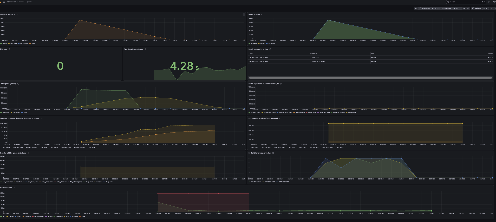
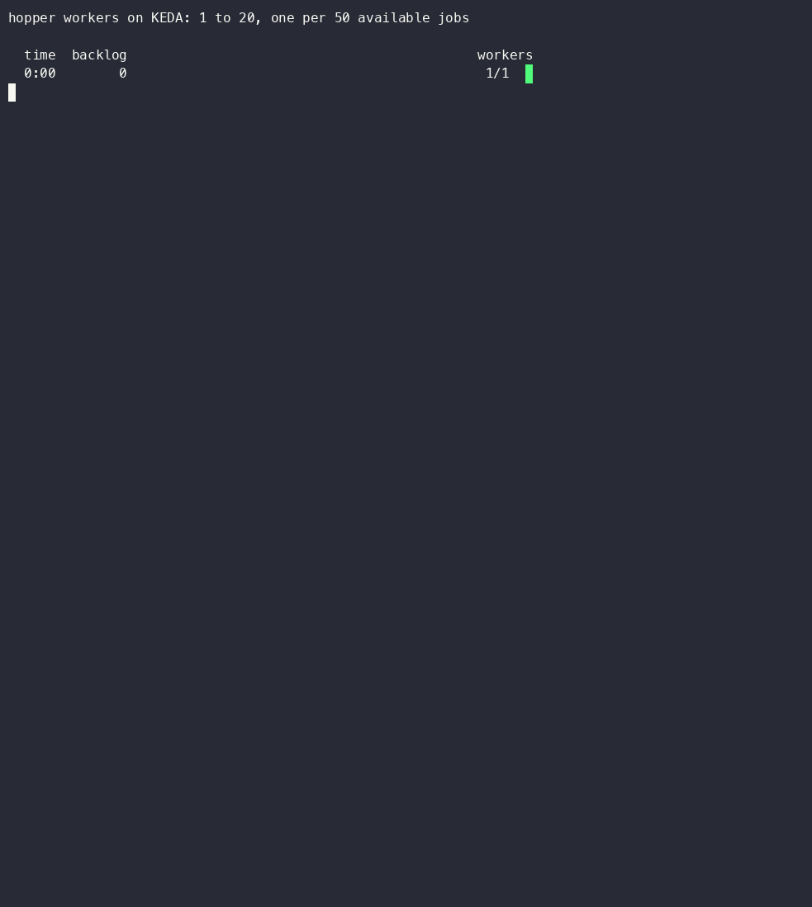

# hopper

A durable, at-least-once job queue built on PostgreSQL, with a gRPC broker and
a Go worker SDK.

PostgreSQL owns every job and every lease transition. Brokers are stateless, so
you can run as many as you like without moving job ownership into process
memory. Workers stream deliveries from a broker with bounded flow control and
renew their leases by heartbeat.

- **At-least-once delivery.** A job is never lost once `Enqueue` returns and is
  never held by two workers at once. It can be redelivered after a lease
  expires, so handlers must be idempotent.
- **Stateless, replicated brokers** in front of a single PostgreSQL.
- **Retries, dead-lettering, priorities, delayed jobs and idempotency keys.**
- **Cron schedules**, run by one leader-elected broker with no double-fires
  across failover.
- **Production-shaped operations:** Prometheus metrics, a Grafana dashboard, a
  Helm chart, KEDA autoscaling on queue depth, and a chaos suite.
- **9,191 jobs/s** drained on one broker on a laptop ([Performance](#performance)).

> **Status:** a prototype for trusted networks. The API is plaintext and
> unauthenticated, and container images are not published yet.

## Quick start

Requires Docker with Compose v2.

```bash
docker compose -p hopper-session7 up -d --build --scale worker=3

# Enqueue 1,000 jobs, then send one more and wait for it to complete.
go run ./cmd/hopperctl enqueue -queue sleep -payload '{"ms":50}' -n 1000 -batch 100 -key-prefix quickstart
go run ./cmd/hopperctl smoke

docker compose -p hopper-session7 logs -f broker worker
docker compose -p hopper-session7 down -v
```

Open the queue dashboard at [127.0.0.1:3000](http://127.0.0.1:3000); no login
is needed.

## Contents

- [Architecture](#architecture)
- [Producing jobs](#producing-jobs)
- [Worker SDK](#worker-sdk)
- [Cron schedules](#cron-schedules)
- [Shutdown and failure handling](#shutdown-and-failure-handling)
- [Observability](#observability)
- [Kubernetes](#kubernetes)
- [Performance](#performance)
- [Development](#development)
- [Repository layout](#repository-layout)

---

## Architecture

```
  producers ──Enqueue──►┌──────────┐           ┌────────────┐
  (client, hopperctl)   │ broker   │──────────►│ PostgreSQL │
                        │ (gRPC,   │  leases,  │ jobs,      │
  workers ◄──Lease──────│ stateless│  acks,    │ leases,    │
  (worker SDK)  stream  │ × N)     │  cron     │ schedules  │
          ──Ack/Nack───►└──────────┘           └────────────┘
          ──Heartbeat─►
```

A job moves through `scheduled → available → leased → completed`. A failed or
expired lease returns it to `available` until it runs out of attempts, then
it goes to `dead`, from which it can be redriven. Background sweeps in the
broker reclaim expired leases and promote due scheduled jobs once a second.

**Guarantees.** Every enqueued job is delivered at least once, and a lease is
held by at most one worker at a time. There is no ordering guarantee across
jobs and no exactly-once execution. Make side effects idempotent using the
stable job ID or a business ID from the payload. `job.Attempt` is delivery
history, not a dedup key.

[docs/semantics.md](docs/semantics.md) is the full contract: job states,
leases, retries and backoff, idempotency keys, fairness, cancellation, every
known source of duplicates (§11), non-goals (§12), and the verified test runs
behind each claim (§15).

## Producing jobs

### Go client

```go
c, err := client.Dial("127.0.0.1:9090") // github.com/rpasco787/hopper/client
if err != nil {
    return err
}
defer c.Close()

res, err := c.Enqueue(ctx, client.Job{
    Queue:          "send_email",
    Payload:        map[string]string{"to": "ada@example.com"},
    IdempotencyKey: "welcome-email-42", // safe to retry: a repeat returns the first job
})
```

`Job` also takes `Priority`, `RunAt` (zero means now) and `MaxAttempts` (zero
takes the broker default). The client provides `EnqueueBatch`, `Cancel` and
`GetJob` as well. `Dial` is lazy, so a producer can start before its broker.

### `hopperctl enqueue`

Bulk-enqueues jobs from the command line. It validates the whole command before
dialing, then sends one bounded batch at a time.

| Flag | Default | Meaning |
|---|---:|---|
| `-broker` | `127.0.0.1:9090` | Broker address; `HOPPER_BROKER` is used when the flag is absent. |
| `-queue` | required | Destination queue. |
| `-payload` | `{}` | JSON payload shared by every generated job. |
| `-n` | `1` | Total jobs to enqueue. |
| `-batch` | `100` | Jobs per RPC, from 1 through 1,000. |
| `-priority` | `0` | Signed 16-bit priority. |
| `-max-attempts` | `0` | Retry limit; zero selects the broker default. |
| `-key-prefix` | empty | Stable keys `<prefix>-<index>`. |
| `-timeout` | `1m` | One deadline for the whole command. |

**Retrying a failed enqueue.** An RPC failure can be ambiguous: writes may have
committed even though no response arrived, including `RESOURCE_EXHAUSTED` on
an oversized response. Do not blindly resend an unkeyed batch. With a stable
`-key-prefix`, rerun the same command: the indexed keys deduplicate while the
original rows still exist. If message size was the problem, use a smaller
batch.

### `hopperctl smoke`

Enqueues one job (queue `sleep`, payload `{"ms":10}` by default) and polls
`GetJob` every `-poll` (250ms) until it completes. It exits 0 on `completed`.
It exits nonzero on `dead`, `cancelled`, no completion within `-timeout` (1m),
or any error other than `UNAVAILABLE`. It rides out `UNAVAILABLE`, so it
tolerates a broker restart or a short database outage. Each run is a new
unkeyed job. It is the check behind the Helm chart's `helm test`.

### Example queues and a larger demo

The example worker (`cmd/worker`) serves three queues:

- `sleep` and `cpu_burn` accept `{"ms":100}`; omitted `ms` defaults to 100.
- `fail_n_times` accepts `{"fail":2}` and fails while `Job.Attempt <= fail`.

To watch a 10,000-job burst drain on the dashboard, start the stack with the
scheduler off, so cron ticks stay out of the `sleep` queue. Use a fresh key
prefix, so a rerun is not deduplicated against the last one:

```bash
HOPPER_SCHEDULER=false docker compose -p hopper-session7 up -d --build --scale worker=3
go run ./cmd/hopperctl enqueue -queue sleep -payload '{"ms":100}' \
  -n 10000 -batch 500 -key-prefix "burst-$(date +%s)"
```

With three workers at concurrency 4, this drains in about 95 seconds.

## Worker SDK

Register handlers during setup, then call `Run` once.

```go
package main

import (
    "context"
    "errors"
    "log"
    "os/signal"
    "syscall"
    "time"

    "github.com/rpasco787/hopper/worker"
)

func main() {
    ctx, stop := signal.NotifyContext(context.Background(), syscall.SIGTERM, syscall.SIGINT)
    defer stop()

    w := worker.New("127.0.0.1:9090", worker.Options{
        ID:              "email-worker-1",
        Concurrency:     8,
        ShutdownTimeout: 30 * time.Second,
    })
    w.Handle("send_email", func(ctx context.Context, job worker.Job) error {
        var payload struct {
            To string `json:"to"`
        }
        if err := job.Unmarshal(&payload); err != nil {
            return err
        }
        // Make the external effect idempotent with job.ID (or a stable business
        // ID), and stop promptly when ctx is cancelled.
        return sendEmailOnce(ctx, job.ID.String(), payload.To)
    })

    if err := w.Run(ctx); err != nil {
        if errors.Is(err, worker.ErrAbandoned) {
            log.Printf("shutdown abandoned work: %v", err)
        }
        log.Fatal(err)
    }
}
```

**Handler context.** It survives the first shutdown signal, so accepted work
can drain. It is cancelled on definitive lease loss, job cancellation, local
lease expiry, or the forced shutdown deadline.

**Leases and capacity.** Before user code starts, each delivery spends one
Heartbeat RPC to prove its lease is still owned. The SDK then renews at one
third of the broker-granted duration. Every Heartbeat pins that original
grant rather than consulting a broker default that may have changed. A
capacity token stays occupied through validation, handler execution, and
Ack/Nack confirmation, so `Concurrency` bounds all of it.

**No metrics dependency.** The SDK imports no metrics library. Set
`worker.Options.Observer` to receive handler start and finish events, as
`cmd/worker` does for its Prometheus metrics.

## Cron schedules

Schedules are declared in a JSON file passed as `-cron-file`
(`HOPPER_CRON_FILE`). The Compose stack mounts
[deploy/cron/schedules.json](deploy/cron/schedules.json) into both brokers:

```json
{
  "schedules": [
    {
      "name": "cpu-burn-5m",
      "queue": "cpu_burn",
      "cron": "*/5 * * * *",
      "timezone": "America/New_York",
      "payload": {"ms": 200},
      "priority": 5,
      "max_attempts": 3
    }
  ]
}
```

| Field | Rules |
|---|---|
| `cron` | A five-field expression, a descriptor such as `@hourly`, or `@every <duration>` (one-second floor). |
| `timezone` | An IANA name; defaults to UTC. |
| `payload` | Defaults to `{}`. |
| `enabled` | Defaults to `true`. |

The broker rejects unknown fields, duplicate names, bad expressions and an
empty `schedules` array at startup, before it listens.

| Flag | Environment | Default | Meaning |
|---|---|---:|---|
| `-cron-file` | `HOPPER_CRON_FILE` | empty | Schedule declarations; empty leaves `cron_schedules` unmanaged. |
| `-scheduler` | `HOPPER_SCHEDULER` | `true` | Contend for the scheduler role in this process. |
| `-scheduler-interval` | `HOPPER_SCHEDULER_INTERVAL` | `5s` | Tick period, and how often a non-leader retries the lock. |

**Leader election.** Every broker contends for one PostgreSQL advisory lock,
and only the holder runs the scheduler. If the leader dies, its session ends,
the lock is released, and another broker takes over on its next
`-scheduler-interval`. Each tick is enqueued with the idempotency key
`<name>@<tick>` and then advanced with a compare-and-swap, so a stalled former
leader cannot double-fire or rewind a schedule.

**Missed ticks.** An overdue schedule, after downtime or a slow failover, fires
once for its pending tick and then skips to the next future occurrence.
History is not backfilled.

**The file is authoritative.** The leader applies it at the start of each
term, and schedules absent from it are deleted. Without a file, the broker
serves whatever rows `cron_schedules` already holds and prunes nothing. There
is no management RPC yet.

**Changing a schedule's queue** starts a new delivery lineage, because
idempotency keys deduplicate within a queue. Change it between ticks, not while
one is in flight.

**Watching failover locally.** Find the leader with
`docker compose -p hopper-session7 logs broker broker-standby | grep "term won"`,
then `docker compose -p hopper-session7 stop <service>`, or `docker kill` its
container for the ungraceful path. The other broker logs `scheduler term won`
within an interval. `broker-standby` publishes no port and workers dial
`broker`, so if you stop `broker`, start it again to let workers drain the jobs
the standby fires.

See [docs/semantics.md §13](docs/semantics.md) for the full contract, including
the two windows in which a tick can fire twice.

## Shutdown and failure handling

**Graceful shutdown.** On `SIGTERM` or `SIGINT`, `cmd/worker` stops accepting
work and uses one deadline for stream teardown, handlers and confirmations. It
exits zero only after a clean drain. If the deadline passes with work still
active, it logs separate delivery, handler, acquisition and confirmation
counts, cancels SDK work, and exits nonzero. Unconfirmed leases then follow the
normal reaper and retry policy. A Go context cannot forcibly stop handler code
that ignores cancellation.

**Confirmation retries are deliberately narrow.** The SDK retries only
transient `UNAVAILABLE` and `DEADLINE_EXCEEDED` failures, and only while its
conservative local lease deadline is live. Generic `INTERNAL` errors are not
retried, because a database mutation may already have committed or the
failure may be permanent.

**Database outages.** Brokers answer `UNAVAILABLE` when PostgreSQL cannot be
reached, so workers keep retrying and ride out an outage that their leases
outlast. With the default 30s lease and prompt failures, an outage under 10s is
always ridden out. The exact rule, set by the last successful renewal, is in
[docs/semantics.md §11.3](docs/semantics.md) with worked examples; §15 has the
runs.

Handlers must stay idempotent, because side effects can duplicate across the
Ack-loss window.

## Observability

Brokers and workers serve Prometheus metrics on a separate HTTP listener that
answers `GET /metrics` only.



| Broker metric | Meaning |
|---|---|
| `hopper_queue_depth{queue,state}` | Jobs `scheduled`, `available`, `leased` and `dead`, sampled every 5s |
| `hopper_queue_depth_last_sample_timestamp_seconds` | When this broker last sampled depth successfully |
| `hopper_jobs_{enqueued,completed,failed,dead}_total{queue}` | Committed transitions; `failed` counts attempts, not jobs |
| `hopper_lease_expirations_total{queue}` | Leases the reaper took back |
| `hopper_job_wait_seconds{queue}` | Due time to first lease |
| `hopper_job_run_seconds{queue}` | Lease to ack, completions only |
| `hopper_db_pool_*` | The PostgreSQL pool: size, connections by state, acquires and waits for a free connection |
| `grpc_server_*` | Standard gRPC server metrics |

| Worker metric | Meaning |
|---|---|
| `hopper_worker_inflight_jobs` | Handlers executing now |
| `hopper_worker_handler_seconds{queue,status}` | Handler wall time; `status` is `ok`, `error` or `panic` |

**Listeners.** `-metrics-listen` (`HOPPER_METRICS_LISTEN`) defaults to
`127.0.0.1:9091` on the broker and is off on the worker. There is one broker
per host and an autoscaler depends on it, whereas several workers on one host
would collide on a default port. When set, the endpoint is mandatory: a bind or
serve failure stops the process.

**Bounded cardinality.** The broker labels only the queues listed in
`-metrics-queues` (`HOPPER_METRICS_QUEUES`) and reports every other queue as
`_other`, so clients cannot create unbounded series. Give every broker the same
list.

> **Reading depth:** every broker reports the same depth. Drop brokers whose
> sample is older than 15s and take `max by (queue, state)`, never `sum`.
> Counters are per-process events, so sum those.

**Logs.** Every broker and worker log line about a delivery carries `job_id`
and `lease_id`, and every other line about a job carries `job_id`, so you can
follow a delivery across both processes by its `lease_id`. Payloads are never
logged, and the broker's per-delivery lines are at debug level.

The counting rule, the depth freshness rule and its KEDA consequence, the wait
definition, histogram resolution and the full log contract are in
[docs/semantics.md §14](docs/semantics.md#14-observability).

### Local endpoints

The Compose stack publishes everything on loopback only. PostgreSQL and the
workers' metrics are not published to the host.

| Service | Address |
|---|---|
| Broker (gRPC) | `127.0.0.1:9090` |
| Broker metrics | `127.0.0.1:9091` |
| Prometheus | `127.0.0.1:9095` |
| Grafana | [`127.0.0.1:3000`](http://127.0.0.1:3000) (queue dashboard, no login) |

## Kubernetes

The Helm chart in `deploy/helm/hopper` deploys a development PostgreSQL, two
brokers behind a ClusterIP Service, and the example workers. It is the only
source of hopper's Kubernetes YAML: `deploy/k8s/hopper.yaml` is rendered from
it.

Requires Docker, [kind](https://kind.sigs.k8s.io/) v0.33.0, kubectl, and Helm 4
(4.3.0 renders `deploy/k8s`). The kind node is pinned to Kubernetes 1.35.8; the
chart needs at least 1.34.

```bash
scripts/kind-up.sh                                    # cluster, images, install
helm --kube-context kind-hopper -n hopper test hopper --logs

kubectl --context kind-hopper -n hopper port-forward svc/hopper-broker 9090:9090 &
go run ./cmd/hopperctl enqueue -queue sleep -n 100 -key-prefix demo-$(date +%s)
```

`scripts/kind-up.sh` does the following:

1. Creates the `hopper` cluster if needed.
2. Builds the broker, worker and `hopperctl` images under a fresh
   `dev-<time>` tag and loads them into the node.
3. Labels the namespace to enforce the restricted Pod Security Standard.
4. Runs `helm upgrade --install --wait`.

Extra arguments go to Helm (`scripts/kind-up.sh --set worker.replicas=3`). It
does not pass `--reuse-values`, so pass every override again on each run. Every
command it runs names the `kind-hopper` context.

`helm test` runs `hopperctl smoke` against the broker Service. It passes only
with a reachable broker, a writable database and a worker serving `sleep`.

| Value | Default | Meaning |
|---|---|---|
| `image.tag` | chart `appVersion` | One tag for all three hopper images |
| `broker.replicas` | `2` | A PodDisruptionBudget (`maxUnavailable: 1`) is rendered above 1 |
| `broker.leaseDuration` | `30s` | Default visibility timeout |
| `broker.metricsQueues` | `[sleep, fail_n_times, cpu_burn]` | Queues with their own metrics label; one list for every replica |
| `broker.cronSchedules` | `[]` | Cron declarations in the `-cron-file` shape; empty leaves schedules unmanaged |
| `broker.{preStopSleep,shutdownTimeout,terminationGracePeriod}Seconds` | `5`, `30`, `45` | Shutdown budget (below) |
| `worker.replicas` | `1` | Example workers |
| `worker.concurrency` | `8` | Active deliveries per worker |
| `worker.{preStopSleep,shutdownTimeout,terminationGracePeriod}Seconds` | `5`, `45`, `60` | Shutdown budget (below) |
| `postgres.password` | `hopper` | **Bootstrap-only.** PostgreSQL applies it only when it initializes an empty volume, and the volume outlives upgrades and `helm uninstall`. A later change reaches the Secret but not the database, and brokers then fail to authenticate. Changing it means deleting the PVC. |

**Shutdown budgets.** Kubernetes counts the grace period from pod deletion, and
the preStop hook runs inside it, so
`terminationGracePeriodSeconds ≥ preStopSleepSeconds + shutdownTimeoutSeconds + 5`.
The chart refuses to render values that break this, and derives
`HOPPER_SHUTDOWN_TIMEOUT` from the same number. The preStop delay uses the
native `sleep` action because the distroless image has no shell or `sleep`.

**Health.** Brokers use native gRPC probes against their `grpc.health.v1`
service. Readiness means "serving", not "database up", and liveness never
depends on the database, so a database outage cannot become a restart storm or
leave the Service with no endpoints. Brokers wait for PostgreSQL in an init
container. Workers have no probes; the SDK reconnects on its own.

**Plain manifests.** `deploy/k8s/hopper.yaml` is the chart rendered with
default values and no test hook. Its header gives the commands to apply it into
a namespace of your choosing. Regenerate it with `scripts/render-k8s.sh`; a
test fails if it drifts from the chart.

### Autoscaling



*20,000 two-second `sleep` jobs take KEDA from 1 worker to 20 and back to 1,
recorded with `scripts/autoscale-watch.sh` during a passing run of
`TestAutoscalingRedeliversNothing`. The left bar is the backlog the
ScaledObject reads; the right bar is running (green) and terminating (red)
workers.*

KEDA scales the workers on the available jobs in their queues, read
fresh-only: one worker per 50 jobs, between 1 and 20 workers. It removes
workers only after 60 s of low backlog.

```bash
scripts/kind-addons.sh                                # kube-prometheus-stack and KEDA
scripts/kind-up.sh -f deploy/kind/autoscaling.yaml    # hopper with monitors and a ScaledObject
scripts/autoscale-watch.sh                            # in a second terminal: backlog and workers, live

kubectl --context kind-hopper -n hopper port-forward svc/hopper-broker 9090:9090 &
go run ./cmd/hopperctl enqueue -queue sleep -n 20000 -batch 500 -payload '{"ms":2000}' -key-prefix demo-$(date +%s)
```

`scripts/kind-addons.sh` installs kube-prometheus-stack 91.7.0 (namespace
`monitoring`) and KEDA 2.20.2 (namespace `keda`) as their own releases, not as
dependencies of the hopper chart, because both own cluster-wide CRDs. For
Grafana, run
`kubectl --context kind-hopper -n monitoring port-forward svc/monitoring-grafana 3000:80`
and open http://127.0.0.1:3000 (anonymous viewer); it serves the same queue
dashboard as Compose. `kind-up.sh` does not reuse values, so pass
`-f deploy/kind/autoscaling.yaml` on every run while you want autoscaling.

| Value | Default | Meaning |
|---|---|---|
| `broker.serviceMonitor.enabled` | `false` | A ServiceMonitor scraping the brokers every 5 s; needs the Prometheus Operator CRDs |
| `worker.podMonitor.enabled` | `false` | A PodMonitor scraping the workers every 5 s; same CRDs |
| `worker.autoscaling.enabled` | `false` | A KEDA ScaledObject for the workers; needs KEDA and `broker.serviceMonitor.enabled`. The Deployment then has no `replicas` |
| `worker.autoscaling.minReplicas` | `1` | Fewest workers; at least 1 |
| `worker.autoscaling.maxReplicas` | `20` | Most workers |
| `worker.autoscaling.availablePerWorker` | `50` | Available jobs per worker (`AverageValue`) |
| `worker.autoscaling.scaleDownStabilizationSeconds` | `60` | The HPA removes workers only after this long of lower recommendations; 0–3600 |
| `worker.autoscaling.fallbackReplicas` | `4` | Held while depth is unknown (below); between the minimum and maximum |
| `worker.autoscaling.prometheusAddress` | `http://prometheus-operated.monitoring.svc:9090` | Where KEDA queries depth; `http(s)://<host>:<port>` |

All three objects are off by default, so `deploy/k8s/hopper.yaml` and clusters
without the CRDs are unaffected. `deploy/kind/autoscaling.yaml` turns all three
on.

**Unknown depth.** When every broker's depth sample is stale, for example
because the database is refusing them, the query returns nothing rather than 0.
The ScaledObject sets `ignoreNullValues: "false"`, so KEDA treats that as an
error instead of an empty queue. After three failed reads it applies the
fallback: it keeps the current count, or raises it to 4 if lower, so it never
removes a worker while it cannot see the backlog. On a fresh install the
fallback can raise the workers to 4 until Prometheus first scrapes the brokers.

**Scale-down and in-flight work.** Kubernetes deletes pods without knowing
which workers are busy, so safety comes from two things. First, a deleted
worker drains: it stops leasing, then finishes and confirms its handlers inside
its shutdown budget, as in a rollout. Second, the 60 s window means the HPA
removes workers only well after the backlog is gone. In the verified cycle the
backlog read 0 at 4m50s and the first worker was removed 38 s later; all 19
removed workers had no handler running at SIGTERM, and no job was redelivered.
A scale-down that did catch a busy worker would still drain it, but a delivery
in flight at SIGTERM could be redelivered.

**Switching it off.** Run
`scripts/kind-up.sh --set worker.replicas=N --force-conflicts`. The flag is
needed because the HPA owns the worker count while autoscaling is on. Then
confirm the count with
`kubectl --context kind-hopper -n hopper get deploy hopper-worker -o jsonpath='{.spec.replicas}'`.
If the HPA synced before KEDA removed it, the count is the HPA's; run the same
upgrade once more. Never `kubectl scale` the workers while autoscaling is on.

The query, the fallback, the scale-down argument and the ownership rule are in
[docs/semantics.md §14](docs/semantics.md#14-observability).

### Limits

- The PostgreSQL is for development: one replica, no backups, and a PVC that
  survives `helm uninstall`. For a fresh database, delete it with
  `kubectl --context kind-hopper -n hopper delete pvc -l app.kubernetes.io/component=postgres`.
  Its password is bootstrap-only (above).
- The API is plaintext and unauthenticated; see
  [docs/semantics.md §12](docs/semantics.md#12-non-goals).
- gRPC is balanced per connection, not per request. Each worker holds one
  connection to one broker, so after a broker restart workers can stay
  concentrated on the surviving broker until they reconnect.
- A worker rollout preserves the pod count, not leasing capacity: with no
  readiness probe, a new worker counts as ready before it is leasing.
- The kind add-ons are for development: one Prometheus with a day of
  retention and no persistence, and no Alertmanager.

Tear down with `kind delete cluster --name hopper`.

## Performance

Measured on one laptop (Apple M2, everything in one Docker VM):

| Scenario | Before | After |
|---|---:|---:|
| Drain 40,000 jobs, 1 broker | 2,131 jobs/s | 9,191 jobs/s |
| Drain 40,000 jobs, 2 brokers | 1,851 jobs/s | 5,001 jobs/s |
| Idle-queue pickup latency (p50) | 85 ms | 1.5 ms |

The gains came from three changes: the lease query was rewritten to read each
queue through its index, the connection pool was sized, and idle lease streams
are now woken on enqueue instead of waiting for the next poll.

At a steady 3,000 jobs a second, the highest rate measured, every run kept up.
Enqueue latency was 1.00 ms p50 / 24.5 ms p99 on one broker and 1.22 ms /
121.5 ms on two.

| Flag | Environment | Default | Meaning |
|---|---|---:|---|
| `-db-max-conns` | `HOPPER_DB_MAX_CONNS` | `16` | PostgreSQL connections per broker; at least 2, or 3 with the scheduler. Brokers × this must fit `max_connections`. |
| `-poll-interval` | `HOPPER_POLL_INTERVAL` | `250ms` | How long an idle lease stream waits without a wakeup. |
| `-debug-listen` | `HOPPER_DEBUG_LISTEN` | empty | pprof profiles; never bind beyond loopback or a private network. |

### Running the benchmarks

```bash
scripts/bench.sh drain
RATE=3000 scripts/bench.sh steady
```

`scripts/bench.sh` documents every setting and keeps each run's evidence:
per-statement database time, pool counters, CPU and, with `PROFILE=1`, a
broker CPU profile. Every benchmark shares the one Docker VM, so stop any kind
cluster first (`docker stop hopper-control-plane`) and keep the machine from
sleeping.

## Development

### Checks

```bash
gofmt -l .
go vet ./...
bash -n scripts/bench.sh
buf lint
helm lint --strict deploy/helm/hopper
helm lint --strict deploy/helm/hopper -f deploy/kind/autoscaling.yaml
go test -race -count=2 ./...
docker compose -p hopper-session7 config
go vet -tags k8s ./test/k8s
go vet -tags chaos ./test/chaos

# The worker SDK must not depend on Prometheus.
! go list -deps ./worker | grep -q prometheus

# Dashboard and autoscaler query semantics, over synthetic series.
docker run --rm --entrypoint promtool -v "$PWD/deploy/prometheus:/p:ro" \
  prom/prometheus:v3.14.0 test rules /p/queries_test.yml

# With the Compose stack up: every dashboard query runs against live Prometheus.
scripts/check-dashboard-queries.sh
```

The integration suite starts PostgreSQL with Testcontainers, so it needs a
running Docker daemon. `test/chart` renders the Helm chart and needs Helm 4 on
`PATH`; it fails, rather than skips, without it. Run `scripts/render-k8s.sh`
with the canonical Helm (`canonicalHelm` in `test/chart`), or the drift test
will report Helm's differences as the chart's.

### Chaos suite

Kills workers, restarts the broker and PostgreSQL, and storms duplicate
enqueues, each against a fresh Compose project `hopper-chaos`. It needs Docker
and takes about 12 minutes a pass:

```bash
go test -tags chaos -count=1 -timeout 60m -v ./test/chaos
```

### Kubernetes proofs

The `k8s` proofs run against the kind cluster, one at a time, and each needs
its release set up its own way:

| Test | What it proves |
|---|---|
| `TestRolloutRestartDuplicatesNothing` | Restarting three workers mid-run under 1,200 three-second jobs starts no job's handler twice. |
| `TestAutoscalingRedeliversNothing` | A 20,000-job scale cycle has no duplicate starts and no redeliveries. |
| `TestUnknownDepthHoldsTheFallback` | With the brokers refused at the database, KEDA holds the fallback. |

```bash
# A fixed worker count; --force-conflicts takes it back from the HPA if
# autoscaling was on.
scripts/kind-up.sh --set worker.replicas=3 --force-conflicts
go test -tags k8s -count=1 -timeout 20m -v -run TestRolloutRestartDuplicatesNothing ./test/k8s

# KEDA and the monitors.
scripts/kind-addons.sh
scripts/kind-up.sh -f deploy/kind/autoscaling.yaml
go test -tags k8s -count=1 -timeout 30m -v -run TestAutoscalingRedeliversNothing ./test/k8s
go test -tags k8s -count=1 -timeout 15m -v -run TestUnknownDepthHoldsTheFallback ./test/k8s
```

## Repository layout

| Path | Contents |
|---|---|
| `cmd/broker` | The gRPC broker, with the cron scheduler and background sweeps |
| `cmd/worker` | The example worker (`sleep`, `cpu_burn`, `fail_n_times`) |
| `cmd/hopperctl` | `enqueue` and `smoke` |
| `cmd/loadgen` | Load generator used by `scripts/bench.sh` |
| `client` | Go producer client |
| `worker` | Go worker SDK |
| `proto`, `gen` | The gRPC API and its generated code |
| `internal` | Broker internals: PostgreSQL store, scheduler, sweeps, metrics |
| `deploy` | Helm chart, rendered manifests, cron, Docker, KEDA, Prometheus and Grafana config |
| `test` | Integration, accounting, chaos, chart and Kubernetes suites |
| `docs` | [semantics.md](docs/semantics.md), the delivery contract |
