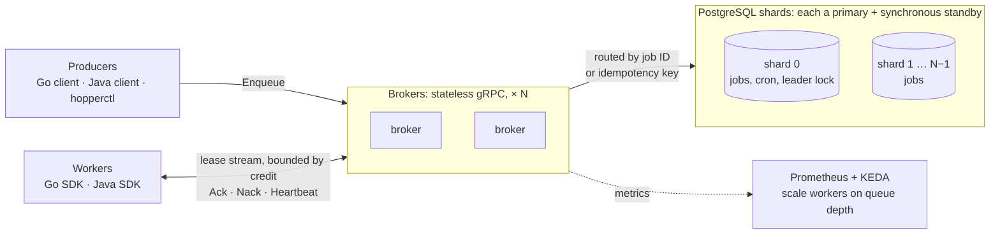

# hopper

A distributed, at-least-once job queue in Go, built on PostgreSQL. It has
stateless gRPC brokers, Go and Java worker SDKs, zero-loss failover under
synchronous replication, and horizontal sharding across N PostgreSQL
databases.

Producers enqueue jobs over gRPC; workers stream them from any broker, run
them and acknowledge them. PostgreSQL owns every job and lease transition, so
brokers hold no job state and any number can run side by side. When one
database's commit rate is the limit, jobs split across independent shards.

The happy path of a queue is easy. The hard part is the failures: a worker
killed mid-job, a broker restart, a primary crash, one shard of four going
down. hopper's contract, [docs/semantics.md](docs/semantics.md), says what
happens in each, lists every way a job can run more than once, and ends with
the dated test run behind each claim.

## Results

| | Result |
|---|---|
| Horizontal scaling | On GKE, 4 PostgreSQL shards drained jobs **3.6×** as fast as one shard (13.1k → 47.0k jobs/s)\* |
| Soak under faults | **10M jobs** on 4 shards, with a worker killed every 3 min, a broker restarted every 15 min and one shard failed over: **0 lost, 0 unexplained repeats**\* |
| Database failover | **0 acknowledged jobs lost** in 8 of 8 primary crashes under synchronous replication on CloudNativePG, 3 of them with replication paused first ([runs](docs/failover/cancelled-wait/summary.md)) |
| Efficiency | PostgreSQL commits per job at one broker cut from **2.24 to 0.29**, in two changes, each measured against its own control ([docs/scaling.md](docs/scaling.md)) |

\* As reported in [docs/sharding/gke/results.md](docs/sharding/gke/results.md),
from a hand-run GKE session whose raw files are not yet committed.

## How it works



A job moves `scheduled → available → leased → completed`, or to `dead` after
its last attempt, from which it can be redriven. Leases are taken with
`FOR UPDATE SKIP LOCKED`, so no two workers hold the same job at once. A job
whose lease expires before its Ack runs again, so handlers are idempotent,
keyed on the job ID. hopper doesn't order jobs or promise exactly-once
execution, and the API is plaintext and unauthenticated
([§12, non-goals](docs/semantics.md#12-non-goals)).

## The hard parts

### Starting a job without a round trip or a clock comparison

Before a handler runs, a worker must know its lease is still live, or it could
run beside the job's next holder. The obvious check, a Heartbeat before every
handler, took about a quarter of PostgreSQL's statement time at one broker and
half of it at four. Comparing the lease timestamp with the worker's clock
would cost nothing, but it would be unsafe, because nothing keeps the two
clocks in agreement.

hopper anchors freshness to flow control instead. A broker leases a row only
against credit the worker has already sent on that stream (a tested
invariant), so the k-th delivery was leased after the k-th unit of credit
arrived. The worker stamps each unit with its own monotonic clock. A delivery
that arrives less than a tenth of a lease after its credit was sent starts at
once, with its deadline counted from that send. No two clocks are ever
compared. In a drain, Heartbeats per job fell from 1.0 to 0, and throughput
rose 1.47× at one broker and 1.49× at four.

→ [design/credit-anchored-freshness.md](docs/design/credit-anchored-freshness.md) ·
[semantics §4](docs/semantics.md#4-lease-visibility-timeout)

### Keeping "never lost" true across a failover

Synchronous replication should mean a committed job survives the loss of the
primary. The failover proof found a gap: when PostgreSQL's wait for the
standby is cancelled, say by a client's deadline, the commit stays and becomes
visible on the primary alone. A producer's retry found that row and was told
`deduplicated`, and a crash then lost the job. That happened to 14 of 19,478
acknowledged jobs over 3 crashes with replication paused for 3 s.

The fix: every read that answers "already done" takes a `FOR KEY SHARE` row
lock, which makes its own commit wait for a standby. WAL is one ordered
stream, so a standby that has the reader's commit has the row it read. The hot
paths are unchanged. After the fix, crashes lost 0 acknowledged jobs in 8 of 8
runs. (The same paused crash under asynchronous replication lost 652 to 694
per run, which is why the chart defaults to synchronous.)

→ [design/cancelled-waits.md](docs/design/cancelled-waits.md) ·
[failover runs](docs/failover/summary.md) ·
[runs before and after the fix](docs/failover/cancelled-wait/summary.md) ·
[semantics §11, item 7](docs/semantics.md#11-where-duplicates-come-from-the-honest-list)

### Sharding without changing the wire protocol

One PostgreSQL's commit flush is the ceiling for one database, so hopper
splits jobs across N independent databases, and every call that names a job
must find its shard. A shard field on the wire would have to be carried by
every SDK and tool; a lookup table would be a new single point of failure.
Instead, byte 9 of the job's UUIDv7 ID, which was random, holds the shard
index. Calls route from the ID alone, so the protocol, the SDKs and the CLI
are unchanged.

- A keyed enqueue goes to `fnv1a64(queue, 0x00, key) mod N`, so a retried key
  always reaches its earlier row and deduplicates.
- An unkeyed enqueue tries another shard only after a failure that certainly
  happened before anything was sent, so sharding adds no duplicates.
- A down shard costs only its own keyed enqueues and jobs. With one of two
  shards stopped for 30 s, the other kept serving and nothing was lost, in 4
  of 4 runs. The costs are listed too: priority holds only within a shard, N
  is fixed, and cron lives on shard 0.

→ [design/sharding.md](docs/design/sharding.md) ·
[sharding report](docs/sharding.md)

### Explaining every duplicate, in two languages

At-least-once delivery means some jobs run twice; what matters is being able
to say why. The accounting harness reconciles every worker's JSON logs with
the database rows and gives each repeated handler start a cause: `nacked`
(the handler failed), `lost` (the worker logged giving up its lease),
`killed` (its process died first), or `acked` (only a lost commit explains
it, so it fails any run that doesn't measure asynchronous replication). A
repeat with no cause fails the run. The chaos suite (killed workers, broker
and PostgreSQL restarts, duplicate-enqueue storms), the Kubernetes proofs and
the soaks are all judged this way.

The same judges hold the Go and Java worker SDKs to one contract. Twelve
conformance scenarios, from a SIGKILLed worker to a missed shutdown deadline,
run against either SDK, and a thirteenth runs two of them on a mixed fleet of
both. The judges were tested too: each of 25 deliberately damaged evidence
sets was caught. Running the chaos suite against the Java worker found a real
bug, since fixed. grpc-java reports a write onto a connection that has just
closed as `UNKNOWN`, where Go reports `UNAVAILABLE`. The Java worker treated
that failure as a refusal and didn't retry its Ack, so the job ran again.

→ [semantics §11, the honest list](docs/semantics.md#11-where-duplicates-come-from-the-honest-list) ·
[design/conformance.md](docs/design/conformance.md) ·
[design/java-worker-sdk.md](docs/design/java-worker-sdk.md)

### Finding the real bottleneck

Adding brokers did not add throughput: four drained slower than one. Rather
than guess, [docs/scaling.md](docs/scaling.md) wrote down each hypothesis and
its prediction before the run, and counted a change as a win only if its
median improved by at least 10% with a range clear of the control's, in the
same interleaved loop. It found:

- Every job cost 2.24 commits, and waiting for PostgreSQL's WAL flush
  dominated at every broker count.
- The per-job `UPDATE`s walked a partial index that stale statistics called
  empty, touching about 76 blocks where about 12 suffice. Production goes
  stale the same way after any quiet period, so this was a real bug. Writing
  the guard as `(state || '') = 'leased'` leaves only the primary key usable.
- Group-committing Acks and Heartbeats, with no timer (a lone call runs at
  once; calls queued behind a running statement share the next one), cut
  commits per job from 2.24 to 0.45. End to end, one broker drained 1.74×
  faster than the original build.
- The benchmark's own layout, 8 workers × 16 slots, held one broker to under
  half its drain rate: 11,348 jobs/s, against 24,330 at 2 × 256.

It also records the hypotheses that didn't hold and what is still open.

→ [docs/scaling.md](docs/scaling.md) ·
[design/confirmation-batching.md](docs/design/confirmation-batching.md)

## Also included

- **Retries with backoff, dead-lettering, priorities, delayed jobs and
  idempotency keys.**
- **Cron without Raft.** One broker holds a PostgreSQL advisory lock and fires
  schedules. Ticks are keyed `<name>@<tick>` and advanced by compare-and-swap,
  so a paused former leader can't double-fire, and a partitioned one loses its
  session after a TTL ([§13](docs/semantics.md#13-cron-schedules-and-leader-election)).
- **Kubernetes operations.** A Helm chart with a CloudNativePG mode,
  Prometheus metrics, a Grafana dashboard, and KEDA autoscaling on queue
  depth that never removes a worker while depth can't be read. One verified
  cycle took 20,000 jobs from 1 worker to 20 and back, with nothing
  redelivered.
- **A Java 25 SDK**, with a producer client and a worker built on virtual
  threads, held to the same contract as the Go SDK.

## Using it

```go
// Producer, with c from client.Dial. A retry with the same key returns the first job.
_, err := c.Enqueue(ctx, client.Job{Queue: "send_email", Payload: email, IdempotencyKey: "welcome-42"})

// Worker
w := worker.New("127.0.0.1:9090", worker.Options{ID: "email-worker-1", Concurrency: 8})
w.Handle("send_email", func(ctx context.Context, job worker.Job) error {
    var p struct{ To string `json:"to"` }
    if err := job.Unmarshal(&p); err != nil {
        return err
    }
    return sendEmailOnce(ctx, job.ID.String(), p.To) // idempotent on the job ID
})
err = w.Run(ctx) // cancelling ctx drains running handlers, then returns
```

The Java client and worker, the CLI and every flag are in
[docs/reference.md](docs/reference.md).

## Quickstart

You need Docker with Compose v2 and Go 1.27.

```bash
# PostgreSQL, two brokers, three workers, Prometheus and Grafana
docker compose up -d --build --scale worker=3

# Enqueue 1,000 jobs, then send one more and wait for it to complete
go run ./cmd/hopperctl enqueue -queue sleep -payload '{"ms":50}' -n 1000 -batch 100 -key-prefix quickstart
go run ./cmd/hopperctl smoke

docker compose logs -f broker worker
docker compose down -v
```

The queue dashboard is at [127.0.0.1:3000](http://127.0.0.1:3000) (no login).

Other ways to run it:

```bash
scripts/kind-up.sh             # the Helm chart on a local kind cluster
go test -race ./...            # unit and integration tests; needs Docker and Helm 4
scripts/conformance.sh all     # Go, Java and mixed-fleet conformance
go test -tags chaos -count=1 -timeout 60m -v ./test/chaos   # the chaos suite, about 12 minutes
```

## Go deeper

- [docs/semantics.md](docs/semantics.md): the contract. It covers job states,
  leases, retries, idempotency, cancellation and cron, plus every known source
  of duplicates (§11) and the dated test run behind each claim (§15).
- [docs/design/](docs/design/): one note per design, most with their
  invariants, failure cases and rejected alternatives, from sharding to the
  [Java worker SDK](docs/design/java-worker-sdk.md) and
  [producer client](docs/design/java-producer-client.md).
- [docs/scaling.md](docs/scaling.md): the broker performance investigation,
  one entry per hypothesis, including the ones that didn't pan out.
- [docs/sharding.md](docs/sharding.md): the sharding report: what was built,
  what was measured, and what's left.
- [docs/failover/summary.md](docs/failover/summary.md): the per-run tables for
  the database failover proofs.
- [docs/reference.md](docs/reference.md): flags, Helm values, metrics, the cron
  file format, the Kubernetes proofs, benchmarks, development checks and the
  repository layout.
