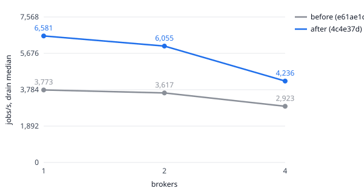

# Scaling brokers in front of one PostgreSQL

What limits hopper's drain throughput as brokers are added, how each
hypothesis was tested, and what changed. One entry per hypothesis, including
the ones that turned out not to matter. Raw evidence is under
`docs/bench/1b/`; every number here is a 5-run median unless it says otherwise.
A change helps when its median is at least 10% better and its range doesn't
overlap the control's, measured in the same interleaved loop.

## The original cause

Adding brokers did not slow hopper down by itself; every job paid for about
2.24 commits (an ownership Heartbeat, an Ack and a share of a lease), and the
PostgreSQL commit flush (`LWLock:WALWrite` and `IO:WALSync`) was most of what
active backends waited on at every broker count, so throughput was flat or
falling whatever the topology. Phase 0 found that the README's 9,191 jobs/s
against 5,001 compared 4 workers with 16, not one broker with two, and that
both topologies reach the same ceiling. H3a showed the per-job updates were
planned against a stale partial index and touched about 76 blocks where about
12 suffice; fixing that ships on correctness, with no measurable throughput
change at four brokers. H2, batching confirmations, cut commits per job from
2.24 to 0.45 at one broker and raised one-broker drain throughput 1.91× in its
loop, but did not help at four, where the ownership Heartbeat (H4) is still
half of statement time. H1, H3's payload sweep and H4 identified what remains:
the Heartbeat before every handler, row copies for payloads of about 1,500
bytes, and more lease calls as the same slots are split over more streams.
(Update 2026-11-23: the Heartbeat before every handler is now skipped for
fresh deliveries; see "Done" under H4.) (H6, 2026-11-25: the 8 × 16 layout
holds one broker to about half its drain, 11,348 jobs/s against 24,330 at
2 × 256.) Measured end to end in one loop, the `after` build drains 1.74×,
1.67× and 1.45× faster than `before` at 1, 2 and 4 brokers, with 5.0×, 3.6×
and 2.4× fewer commits per job, but more brokers still cost throughput against one
PostgreSQL.

## Setup

- Commit `e61ae1c` (BASE) for "before"; each entry names its own. The harness
  revision is in every row's `harness` column (`b762273` for the baseline).
- Apple M2 laptop, one Docker VM with 8 vCPUs, `PIN=1`: PostgreSQL on CPUs
  0–1, every broker allowed CPUs 2–3, workers on 4–6, the load generator on 7.
  The brokers' CPU budget is two CPUs at 1, 2 and 4 brokers alike, so these
  runs show what more brokers *cost* against one PostgreSQL. Capacity scaling
  needs separate machines (cloud session A). Phase 0 gave a lone broker one
  CPU, so its numbers aren't directly comparable with these.
- 8 workers × 16 slots (128 at every broker count), 40,000 jobs of 300 bytes,
  drained after a preload. H6 measures what this layout costs at one broker.
  PostgreSQL 16, `synchronous_commit=on`, `fsync=on`,
  `wal_sync_method=fdatasync`.

## Baseline

Evidence: `docs/bench/1b/b0/` (2026-11-15).

| Brokers | Jobs/s (range) | Commits/job | WAL syncs/job | WALWrite+WALSync % | Ack p99 ms | Heartbeat p99 ms |
|---:|---|---:|---:|---:|---:|---:|
| 1 | 4,889 (4,102–5,003) | 2.24 | 0.433 | 87.0 | 24.26 | 23.85 |
| 2 | 4,746 (4,602–5,013) | 2.23 | 0.256 | 89.2 | 24.50 | 24.42 |
| 4 | 4,369 (4,062–4,494) | 2.23 | 0.163 | 70.0 | 31.04 | 34.26 |

The p99s are interpolated inside the brokers' histogram buckets (…10, 25,
50 ms…), so they are only as fine as those buckets.

Reference points, 5 runs each, interleaved with the baseline
(`docs/bench/1b/b0-async/`, `docs/bench/1b/b0-delay/`):

| Brokers | `synchronous_commit=off` jobs/s (range) | vs baseline | `commit_delay=200, commit_siblings=5` jobs/s (range) | vs baseline |
|---:|---|---|---|---|
| 1 | 6,472 (5,961–6,723) | 1.32× (helps) | 3,768 (3,642–3,985) | 0.77× (hurts: ranges apart) |
| 2 | 5,421 (4,816–5,440) | 1.14× (no measurable effect: ranges overlap) | 5,087 (4,836–5,373) | 1.07× (no measurable effect) |
| 4 | 3,921 (3,024–4,108) | 0.90× (no measurable effect: ranges overlap) | 4,638 (4,281–4,682) | 1.06× (no measurable effect) |

Statement time (from `statements.txt`, 1 broker): heartbeat 41.1%, ack 38.4%,
lease 18.3%; blocks per call: heartbeat 76.0, ack 75.8, lease 150.1.

What the baseline says, as diagnostics rather than verdicts:

- **Commits per job are 2.23–2.24 at every broker count**, as predicted (one
  heartbeat, one ack, about 0.22 of a lease statement, plus a little polling).
- **PostgreSQL already shares flushes.** WAL syncs per job are 0.43 at one
  broker and 0.16 at four, against 2.2 commits: one `fdatasync` covers about
  5 commits at one broker and about 14 at four. More backends waiting means
  bigger groups, not more flushes.
- **Waiting for the flush limits one broker, not four.** Turning
  `synchronous_commit` off is 1.32× faster at one broker. At two and four it
  is not measurably faster, and at four the runs without any flush wait are
  spread over 3,024–4,108 jobs/s. With the flush gone, the waits move to
  Lock and LWLock (83% of samples at four brokers) and lease blocks per call
  grow from 166 to 385. More backends contend for the same rows and pages
  instead.
- **`commit_delay` buys nothing.** It is measurably slower at one broker
  (0.77×) and not measurably different at two and four. It does cut WAL
  syncs per job (0.43 to 0.23 at one broker), so fewer flushes alone did not
  make the drain faster. Why it costs a lone broker throughput wasn't
  measured.
- **Every per-job update touches about 76 blocks.** A single-row update by
  primary key should touch about 10. H3a below explains why.

## Hypotheses

### H3a: per-job updates walk the partial lease-expiry index

- **Setup:** `e61ae1c` before, `654c140` after; 1 and 4 brokers, 8 workers ×
  16 slots, 300-byte payloads, `PIN=1` as above. Evidence:
  `docs/bench/1b/b0-explain/` (plans), `docs/bench/1b/h3a/` (measurement,
  2026-11-15, one interleaved loop of 20 runs).
- **Prediction:** `jobs_reap_idx` is partial (`where state = 'leased'`), and
  the guard `state = 'leased'` lets the planner use it. The bench analyzes
  `jobs` right after the preload, when nothing is leased, so the statistics
  call that index empty. A plan that trusts them walks the leased rows to
  find one id. If so, Heartbeat and Ack plans name `jobs_reap_idx`, and their
  blocks per call grow with the in-flight count while a primary-key lookup
  stays near 10.
- **Measurement:** `auto_explain` samples (`EXPLAIN=1`) of a drain at 1 and 4
  brokers; blocks per call from `pg_stat_statements`; a store test that
  analyzes 20,000 idle rows, leases 128 and plans both statements (custom and
  generic).
- **Before:** 296 of 299 sampled Heartbeat and Ack plans used the partial
  index, with the id only a filter:

  ```
  Update on jobs  (actual rows=1 loops=1)
    Buffers: shared hit=40
    ->  Index Scan using jobs_reap_idx on jobs  (actual rows=1 loops=1)
          Filter: ((id = $1) AND (lease_id = $2) AND (state = 'leased'::text))
          Rows Removed by Filter: 25
  ```

  Blocks per call: heartbeat 76.0 and ack 75.6 at one broker, 140.2 and
  142.3 at four. The store test reproduced the same plan in all four cases.
- **Change:** `654c140` writes the guard as `(state || '') = 'leased'` in
  `ackSQL` and `extendSQL`. It means the same thing (state is never null),
  and the planner cannot prove the partial index's predicate from it, so
  only `jobs_pkey` can serve the id. Considered and rejected: stopping the
  bench from analyzing after the preload. That only fixes the benchmark,
  since production sees the same stale statistics after any quiet period,
  and it could not pass the store test, which runs its own `VACUUM ANALYZE`.
  Before measuring, the delivery path was rechecked: the full suite with
  `-race -count=2`, the outage tests `-count=5`, and three chaos tests, all
  passing with no repeated handler starts (`docs/semantics.md` §15).
- **After:** blocks per call: heartbeat 11.8 and ack 11.9 at one broker, 12.7
  and 13.8 at four.

  | Brokers | Before jobs/s (range) | After jobs/s (range) | Ratio | Ack p99 ms before → after | Heartbeat p99 ms before → after |
  |---:|---|---|---:|---|---|
  | 1 | 4,864 (4,381–4,950) | 5,170 (4,021–5,311) | 1.06× | 23.90 → 23.51 | 23.55 → 23.03 |
  | 4 | 4,149 (3,831–4,345) | 4,933 (4,274–5,026) | 1.19× | 31.47 → 24.30 | 35.01 → 27.11 |

- **Conclusion:** confirmed as a plan defect, and fixed: each per-job update
  now touches 12–14 blocks instead of 76–142, at every broker count. The
  throughput effect is *not measurable* under the evidence rule: at one
  broker the medians are 6% apart, and at four the 19% gain's ranges overlap
  by 71 jobs/s (4,274 against 4,345). The fix ships on correctness, not on
  speed: it removes work that grew with the in-flight count, and it keeps
  H2's measurement from crediting batching with it. Plan 1b-2's batched
  statements must use the same guard form.


### H2: one commit per confirmation

- **Setup:** code and harness `3aaf0c1` for all four variants: batching off,
  batching at 64 with two flights, batching at 64 with one flight, and
  batching off with `synchronous_commit=off`. 1, 2 and 4 brokers; 8 workers ×
  16 slots, 40,000 jobs, 300-byte payloads, `PIN=1` on the eight-CPU Docker VM.
  Five runs per configuration in one 60-run interleaved loop, rotating the
  starting variant each repetition, under `caffeinate -dimsu`. Ran
  2026-11-16–17 (America/Chicago), 05:38:09–06:29:56 UTC on 2026-11-17.
  All refs and harnesses are clean; zero retried jobs, rejected runs or
  replacement runs. Evidence: [H2 results](bench/1b/h2/results.csv),
  [loop](bench/1b/h2/loop.sh), [loop log](bench/1b/h2/loop.log),
  [summary](bench/1b/h2/summary.md),
  [full comparison](bench/1b/h2/comparison.md).
- **Prediction:** commits per job fall from about 2.2 to 0.3–0.5 as concurrent
  Acks and Heartbeats share statements and commits; flush-wait share and
  active backends should fall too. Whether throughput improves is measured,
  not assumed.
- **Measurement:** cumulative commit/WAL counter deltas, sampled active
  PostgreSQL backends and wait events, exact `pg_stat_statements` calls/rows
  for both confirmation kinds, and paired per-broker RPC histograms.
  Submitted batch size is RPC calls per batch statement, including pairs
  that fell back; fallback share is one-row statement calls per RPC.
  The gate uses unrounded ratios from `confirmations.txt` and `rpc.txt`;
  the general summary displays one decimal. Confirmation statements/job
  below is the sum of Ack and Heartbeat batch and one-row calls divided by
  40,000; it excludes lease and housekeeping statements. p99 values are
  interpolated within fixed histogram boundaries (0.5, 1, 2.5, 5, 10, 25,
  50, 100, 250, 500, 1000, 2500, 5000 ms), not millisecond-accurate samples.
- **Before:** the same-loop `nobatch` medians are 3,369 / 3,406 / 3,845 jobs/s
  at 1 / 2 / 4 brokers, with 2.24 / 2.23 / 2.23 commits/job and exactly
  2.000 confirmation statements/job. These are the controls for this
  experiment; the earlier baseline and H3a loops are not comparison inputs.
- **Change:** tasks 1–8 implement separate no-timer Ack and Heartbeat
  batchers, lock-skipping statements, per-caller fallback, cancellation and
  shutdown joining. Task 9 (`3aaf0c1`) adds exact confirmation counts.
  This experiment switches the same build through configuration only.
  Production defaults remain `confirm-batch=1`, `confirm-flights=2` pending
  explicit approval. A proposed `64`/`2` default change is retained in
  [proposed-default.patch](bench/1b/h2/proposed-default.patch), not applied.
- **After:** all cells below are five-run medians, with throughput ranges.
  The fallback columns use exact ratios before formatting.

#### 1 broker


| Variant | Jobs/s (range) | Commits/job | WAL syncs/job | Confirmation statements/job | WALWrite+WALSync % | Active backends | Ack/HB p99 ms | Submitted batch Ack/HB | Exact fallback % Ack/HB |
|---|---|---:|---:|---:|---:|---:|---|---|---|
| nobatch | 3,369 (2,039–4,725) | 2.24 | 0.425 | 2.000 | 81.7 | 9.89 | 49.59/48.19 | – | – |
| batch | 6,446 (5,304–8,170) | 0.45 | 0.142 | 0.227 | 82.3 | 6.00 | 28.25/33.72 | 11.0/10.6 | 0.003/4.027 |
| batch-flights1 | 7,251 (6,832–8,895) | 0.32 | 0.137 | 0.117 | 80.0 | 3.17 | 24.60/23.82 | 19.9/19.3 | 0.000/1.490 |
| async | 5,277 (4,281–6,701) | 2.24 | 0.002 | 2.000 | 0.0 | 1.88 | 37.83/35.25 | – | – |

#### 2 brokers

| Variant | Jobs/s (range) | Commits/job | WAL syncs/job | Confirmation statements/job | WALWrite+WALSync % | Active backends | Ack/HB p99 ms | Submitted batch Ack/HB | Exact fallback % Ack/HB |
|---|---|---:|---:|---:|---:|---:|---|---|---|
| nobatch | 3,406 (2,753–4,793) | 2.23 | 0.259 | 2.000 | 90.3 | 20.33 | 59.17/54.32 | – | – |
| batch | 4,645 (4,168–6,599) | 0.62 | 0.131 | 0.386 | 79.3 | 8.44 | 47.21/46.81 | 6.3/6.2 | 0.058/6.415 |
| batch-flights1 | 4,232 (2,573–7,826) | 0.43 | 0.135 | 0.216 | 75.9 | 5.33 | 75.40/78.18 | 11.0/10.8 | 0.000/3.170 |
| async | 6,185 (3,272–6,372) | 2.23 | 0.002 | 2.000 | 0.0 | 6.57 | 23.24/23.98 | – | – |

#### 4 brokers

| Variant | Jobs/s (range) | Commits/job | WAL syncs/job | Confirmation statements/job | WALWrite+WALSync % | Active backends | Ack/HB p99 ms | Submitted batch Ack/HB | Exact fallback % Ack/HB |
|---|---|---:|---:|---:|---:|---:|---|---|---|
| nobatch | 3,845 (1,457–4,147) | 2.23 | 0.180 | 2.000 | 75.8 | 37.50 | 48.84/48.57 | – | – |
| batch | 3,800 (2,094–5,087) | 0.93 | 0.128 | 0.657 | 71.9 | 15.38 | 61.79/69.52 | 3.6/3.5 | 0.340/9.068 |
| batch-flights1 | 3,546 (3,130–5,077) | 0.62 | 0.131 | 0.371 | 76.5 | 8.67 | 49.91/70.53 | 6.1/6.1 | 0.050/4.228 |
| async | 3,676 (3,010–5,227) | 2.21 | 0.002 | 2.000 | 0.0 | 13.20 | 48.24/50.00 | – | – |


- **Conclusion:** confirmation batching with **two flights qualifies** under
  the written rule. At one broker, 6,446 jobs/s (5,304–8,170) is 1.913× the
  control's 3,369 (2,039–4,725), with separated ranges. At two brokers the
  1.364× median gain has overlapping ranges, so it is no measurable gain;
  at four, the median is 0.988× the control, above the 0.95 floor. The largest
  median p99 ratio is Heartbeat at four brokers, 1.431×, below 1.5×. Exact
  median Heartbeat fallback shares are 4.0275%, 6.4150%, 9.0675%; the largest
  individual-run share is 9.7300%. Ack fallback is at most 0.34% by median.
  Both kinds stay below the 10% gate. The four-broker latency and fallback
  margins are narrow and should remain visible in the decision.

  The one-flight variant **does not qualify**: although it helps at one
  broker, its four-broker median is 3,546 / 3,845 = 0.922×, below 0.95×.
  The rule's output is:

  ```text
  batch qualifies: True
  batch-flights1 qualifies: False
  ```

  [decision.txt](bench/1b/h2/decision.txt) retains every broker-count ratio,
  p99 ratio and exact fallback share; [evaluate.py](bench/1b/h2/evaluate.py)
  reproduces the calculation. Independent evidence review confirmed all
  60 settings/positions, exact RPC and applied-row counts, and decisions.
  **Proposed decision: enable batch size 64 with two flights. Not enabled
  yet; user approval is required.**

  The prediction is partly confirmed: two-flight commits/job fall to
  0.45 / 0.62 / 0.93, and WAL syncs/job to 0.142 / 0.131 / 0.128.
  The 0.3–0.5 commit target is reached at one broker only; submitted batches
  get smaller as more brokers split the traffic, and Heartbeat fallback
  grows. Active backends fall from 9.89 / 20.33 / 37.50 to
  6.00 / 8.44 / 15.38. Flush-wait *share* remains high (82.3% / 79.3% /
  71.9%), including no reduction at one broker, despite fewer active
  backends. It was not correct to predict that share would fall everywhere.

  The fixed-build async reference has higher medians at one and two
  brokers (1.57× and 1.82×), but ranges overlap at **every** broker count.
  This loop therefore establishes no measurable throughput gain from
  disabling synchronous commit under the written rule; it does not prove
  flush waiting has no cost. Async remains a diagnostic durability tradeoff,
  not a proposed production setting.

  Remaining statement costs are recorded in
  [statements-summary.md](bench/1b/h2/statements-summary.md). With two-flight
  batching at four brokers, Heartbeat fallbacks alone consume a median
  35.5% of statement execution time (3.014 ms/call), compared with 17.3%
  for Heartbeat batches and 15.1% for Ack batches; leasing is 27.0%.
  The four-broker async reference spends 50.6% in one-row Heartbeats.
  These diagnostics keep ownership-heartbeat work (H4) relevant for plan
  1b-3, without starting that work here.
- **Verification:** tasks 6–8 passed before measurement: the full race suite
  twice, batching-on integration twice, four confirmation-fault tests three
  times, both deadline tests three times, outage tests five times, and the
  three requested chaos tests including graceful/crash restart subcases.
  Chaos reported zero repeated handler starts, and all ten saved broker logs
  announced batching. Removing last-caller cancellation via a Go overlay
  made the deadline regression fail as intended; normal cancellation passed.
  Details: [verification note](bench/1b/h2-verification.md). Task 9 passed
  32 harness, 18 summary and 6 histogram tests plus shell syntax checking.
  Its 5,000-job smoke check observed both batch statements and all applied
  rows, including fallback. No correctness assertions or fault injections
  were weakened. Task 11 documentation was completed on 2026-11-17 using
  this existing evidence; the user explicitly skipped all close-out verification reruns.
  No skipped check is recorded as a pass. The remaining-plan handoff is in
  [h2/handoff.md](bench/1b/h2/handoff.md).

### H4: the ownership heartbeat before every handler

- **Setup:** `7b77052` for both variants. 1 and 4 brokers; 8 workers × 16
  slots, 40,000 jobs, 300-byte payloads, `PIN=1` on the eight-CPU Docker VM.
  Batching at its default (64, two flights). Five runs per configuration in
  one 20-run interleaved loop, rotating the starting configuration each
  repetition, under `caffeinate -dimsu`. Ran 2026-11-19, 23:43:51–23:59:30
  UTC. Zero failed or rejected runs; all ten `skip` runs logged the switch.
  Evidence: [H4 results](bench/1b/h4/results.csv),
  [prediction](bench/1b/h4/prediction.txt), [loop](bench/1b/h4/loop.sh),
  [loop log](bench/1b/h4/loop.log), [summary](bench/1b/h4/summary.md),
  [decision](bench/1b/h4/decision.txt).
- **Prediction** (written before the first run): in a drain, handlers do no
  work, so almost every Heartbeat is the ownership check. With it skipped,
  Heartbeat batches and fallbacks go to zero, commits per job fall by about
  the Heartbeat share (0.45 to about 0.25 at 1 broker, 0.93 to about 0.5 at
  4), and the 4-broker Heartbeat fallbacks vanish. Whether jobs/s follows was
  open.
- **Measurement:** `scripts/bench_compare.py` on `results.csv`;
  `commits_per_job`, `heartbeat_batch` and `heartbeat_fallback_pct` from the
  harness; the Heartbeat share of statement time is the summed `pct_of_total`
  of the `update jobs set lease_expires` and `with mine as ( select j.id,
  c.dur_us` statements in each run's `statements.txt`, median over five runs.
- **Before (`check`):** 7,880 jobs/s (4,432–8,376) at 1 broker and 4,743
  (2,726–5,039) at 4. 0.44 / 0.93 commits per job. Heartbeat batch size 10.4 /
  3.5, fallback share 3.8% / 9.4%. Heartbeats are 27.7% / 49.6% of statement
  time.
- **Change:** `HOPPER_BENCH_SKIP_OWNERSHIP_CHECK=1` on the workers
  (`7b77052`): handlers start on a deadline guessed from receipt time, with no
  Heartbeat. Unsafe by design; benchmarks only.
- **After (`skip`):** 10,708 jobs/s (10,188–11,082) at 1 broker and 7,658
  (3,372–7,969) at 4. 0.28 / 0.52 commits per job. No Heartbeat statements
  at all. Lease mean 0.35 to 0.41 ms at 1 broker and 0.70 to 0.68 ms at 4.
- **Decision:**

  | Metric | Brokers | Verdict |
  |---|---:|---|
  | jobs/s | 1 | **helps**, 1.359× (ranges separate) |
  | jobs/s | 4 | 1.615×, ranges overlap: no measurable effect |
  | commits/job | 1 | helps, 1.571× fewer |
  | commits/job | 4 | helps, 1.788× fewer |

- **Conclusion:** confirmed. The ownership Heartbeat is the largest remaining
  per-job cost in a drain: about half of statement time at 4 brokers. Its
  removal moved commits per job exactly as predicted. The 4-broker jobs/s
  gain is large but not established, because the `check` runs are widely
  spread. Skipping the check unconditionally is unsafe, so this is a policy
  change and a core design (ground rule 1), not something this plan ships.
  Follow-up, chosen by the user: **credit-anchored freshness**. The broker
  never leases more rows than credit it has received, so the k-th delivery on
  a stream was leased after the worker sent its k-th unit of credit. The
  worker can bound a delivery's age on its own monotonic clock, as receipt
  minus that unit's send time, and skip the check when the bound is well
  under the grant, setting the local deadline from the credit's send time
  (as conservative as `deadlineFrom(sent, grant)`). A job cancelled before it
  starts is then noticed at the first renewal or the Ack, which §10 already
  allows. It needs its own plan. Rejected: skipping when a delivery arrives
  within a fraction of the grant, which compares the worker's clock with the
  database's.

- **Done (2026-11-23).** The design is
  [design/credit-anchored-freshness.md](design/credit-anchored-freshness.md),
  committed before any code, and the rule is in [semantics.md](semantics.md) §4.
  A delivery read less than G/10 after the credit unit it was matched to was
  sent starts at once, on `deadlineFrom(sent, G)`; any other takes the bounded
  ownership Heartbeat. The broker half is pinned by two new tests and a guard
  (a store returning more rows than asked ends the stream `INTERNAL`).
  - **Setup:** `770fdb5` (`before`, the check on every delivery) against
    `170c385` (`after`). 1 and 4 brokers; 8 workers × 16 slots, 40,000 jobs,
    300-byte payloads, `PIN=1` on the eight-CPU Docker VM, batching at its
    default. Five runs per configuration in one 20-run interleaved loop,
    rotating the starting configuration each repetition, under
    `caffeinate -dimsu`. Ran 2026-11-23, 22:26:27–22:42:51 UTC. Zero failed or
    rejected runs. Evidence: [results](bench/1b/h4-credit/results.csv),
    [prediction](bench/1b/h4-credit/prediction.txt),
    [loop](bench/1b/h4-credit/loop.sh), [decision](bench/1b/h4-credit/decision.txt),
    [summary](bench/1b/h4-credit/summary.md).
  - **Prediction** (written before the first run): Heartbeat calls per job fall
    from about 1.0 to under 0.01 at both broker counts; commits per job fall to
    about 0.28–0.30 at 1 broker (before about 0.44) and 0.52–0.56 at 4 (before
    about 0.93), `helps` at both; jobs/s `helps` at 1 broker and open at 4. If
    commits per job at 1 broker stayed above 0.35, or Heartbeat calls per job
    above 0.1, the matching would be wrong.
  - **Result:**

    | Metric | Brokers | `before` | `after` | Verdict |
    |---|---:|---|---|---|
    | jobs/s | 1 | 6,099 (5,717–6,879) | 8,937 (8,543–10,143) | **helps**, 1.465× (ranges separate) |
    | jobs/s | 4 | 4,060 (3,956–4,297) | 6,031 (5,109–7,515) | **helps**, 1.485× (ranges separate) |
    | commits/job | 1 | 0.45 (0.44–0.45) | 0.29 (0.28–0.29) | **helps**, 1.552× fewer |
    | commits/job | 4 | 0.92 (0.91–0.92) | 0.51 (0.50–0.52) | **helps**, 1.804× fewer |
    | Heartbeat calls/job | 1 and 4 | 1.000 | 0.000 | as predicted |
    | Heartbeat share of statement time | 1 / 4 | 27.5% / 50.7% | 0.0% / 0.0% | as predicted |

    Everything fell inside or beyond the prediction. The 4-broker commits per
    job, 0.51, is just under the predicted 0.52–0.56, and 4-broker throughput,
    left open, came out `helps`. Both variants still show four brokers slower
    than one (0.67×), as in H4's own runs: this change doesn't touch that.
  - **The benchmark switch is retired.** `HOPPER_BENCH_SKIP_OWNERSHIP_CHECK`
    and `Options.SkipOwnershipCheckForBenchmarks` (`7b77052`) are gone. With
    zero Heartbeat calls per job in a drain, the switch removed nothing the
    normal path still does, and keeping an unsafe-by-design option in the SDK
    surface the Java worker copies had no benefit. The old baseline stays
    reproducible with `REF=770fdb5 WORKER_ENV=HOPPER_BENCH_SKIP_OWNERSHIP_CHECK=1
    scripts/bench.sh drain` (or any ref from `7b77052` to the retiring commit).

### H1: lessor contention at the head of the index

- **Setup:** `7b77052`, 1 broker, 128 slots split three ways: 4 workers × 32,
  8 × 16 and 16 × 8 (lease streams 4, 8 and 16). 40,000 jobs, 300-byte
  payloads, batching at its default, `PIN=1`. Five runs per configuration in
  one 15-run interleaved loop, under `caffeinate -dimsu`. Ran 2026-11-20,
  00:01:23–00:12:55 UTC. Zero failed or rejected runs. Evidence:
  [H1 results](bench/1b/h1/results.csv), [loop](bench/1b/h1/loop.sh),
  [loop log](bench/1b/h1/loop.log), [summary](bench/1b/h1/summary.md),
  [decision](bench/1b/h1/decision.txt).
- **Why now, revised:** the first draft said batching would remove the flush
  ceiling and leave the lease query exposed. It didn't: flush waits are still
  75–81% of active-backend samples here. But leasing was already 27.0% of
  statement time at 4 brokers in H2, so the question stands, and the gate is
  unchanged.
- **Prediction:** if streams contend for the head of the index, lease latency
  per call grows with the stream count at fixed slots, and a coalescer that
  merges streams would help.
- **Measurement:** lease query (`with next as …`) mean time, blocks and rows
  per call, and share of statement time from `pg_stat_statements`, plus
  jobs/s, five-run medians.
- **Results:**

  | Streams | jobs/s (range) | Lease mean | Lease blks/call | Rows/call | Lease share | Commits/job |
  |---:|---|---:|---:|---:|---:|---:|
  | 4 | 10,385 (3,706–10,545) | 0.329 ms | 218.2 | 7.40 | 41.0% | 0.35 |
  | 8 | 7,787 (6,208–8,355) | 0.342 ms | 184.4 | 4.60 | 50.6% | 0.44 |
  | 16 | 5,342 (2,978–5,839) | 0.410 ms | 158.4 | 2.90 | 60.0% | 0.59 |

- **Gate:** confirmed only if the lease is at least 25% of statement time
  *and* lease ms at 16 streams is at least 1.5× that at 4 streams with
  rows/call within ±20%. The share holds (41–60%). The latency ratio is 1.25×
  and rows/call fall from 7.40 to 2.90, so **the gate is not met**.
- **Conclusion:** rejected as stated, with a finding the gate doesn't
  capture. A lease call does not get much slower with more streams; there
  are more of them and each returns fewer rows, so the lease share of
  statement time rises from 41% to 60%, commits per job rise from 0.35 to
  0.59, and median jobs/s falls by half. The ranges overlap pairwise (the
  4-stream range has one low run), so the throughput trend is suggestive, not
  established under the evidence rule. If the gate is revisited, the thing to
  measure is lease *calls per job* against stream count, not latency per
  call. A coalescer merges streams on one broker only: at 4 brokers with 2
  workers each it can merge at most 2 streams, so its possible gain shrinks as
  brokers increase. No coalescer is designed or shipped here.

### H3: full-row rewrites and index churn

- **Setup:** payload sweep on `cf2d835`: 1 broker, 8 workers × 16 slots, 40,000
  jobs, batching at its default, `PIN=1`, payloads of 0, 300 and 1,500 bytes.
  Five runs per size in one 15-run interleaved loop. Ran 2026-11-20,
  00:15:49–00:27:03 UTC. Zero failed or rejected runs. Evidence:
  [H3 payload results](bench/1b/h3-payload/results.csv),
  [prediction](bench/1b/h3-payload/prediction.txt),
  [loop](bench/1b/h3-payload/loop.sh), [summary](bench/1b/h3-payload/summary.md).
- **Prediction** (written before the first run): HOT stays at 0%, because every
  per-job update changes an indexed column (lease and Ack change `state`, which
  the partial-index predicates read; Heartbeat changes `lease_expires`). WAL per
  job grows with payload size, because each update copies the whole row, even
  under the TOAST threshold of about 2 KB.
- **Measurement:** `hot_update_pct`, `wal_kb_per_job` and jobs/s from the
  harness, five-run medians.
- **Results:**

  | Payload | jobs/s (range) | WAL KB/job | HOT % | Commits/job |
  |---:|---|---:|---:|---:|
  | 0 B | 8,589 (7,410–8,709) | 1.16 | 0.0 | 0.45 |
  | 300 B | 8,252 (7,389–8,730) | 1.54 | 0.0 | 0.44 |
  | 1,500 B | 5,622 (5,243–6,467) | 5.23 | 0.0 | 0.45 |

- **Decision:**
  - HOT was 0.0% in every run, as predicted.
  - WAL per job rose 4.5× from 0 to 1,500 bytes, and jobs/s at 1,500 B is
    34.5% below 0 B with separate ranges (6,467 against 7,410). The payload
    gate is met: row copies matter.
  - 300 B costs about 4% against 0 B with overlapping ranges, so the cliff is
    between 300 and 1,500 bytes, below the TOAST threshold.
  - A narrow state table beside an insert-only payload table is a schema
    change and a core design (ground rule 1). It is **not built here** and
    needs its own plan.
- **Drift pair (default against tuned storage settings): not measured in Phase
  1b.** The 10-minute steady runs never met the evidence rule's precondition.
  At `RATE=4000` the first run enqueued 1,762 jobs/s (producers 762 s behind,
  `kept_up=no`); at `RATE=1000` it enqueued 850 jobs/s with enqueue p50 of 11.9
  s and 110 s of maximum lag (`kept_up=no`). Both were stopped and kept as
  non-results ([rate 4000](bench/1b/h3-drift-rate4000/NOTE.txt),
  [rate 1000](bench/1b/h3-drift-rate1000/NOTE.txt)). A third attempt at
  `RATE=500` was stopped before any run finished, to protect the close-out
  ([note](bench/1b/h3-drift/NOTE.txt)). The `fillfactor` and autovacuum settings
  were therefore **not shipped**: no migration `003`. The rate-1000 trace shows
  the lease mean wandering from 0.19 to 2.3 ms and live tuples growing to
  600,000, but under a producer that was falling behind, so it is not evidence
  of drift.
- **Conclusion:** partly. HOT and the payload sweep are answered; the drift and
  storage-settings question is open. The achieved enqueue rate in a steady run
  (1,762 jobs/s offered 4,000; 850 offered 1,000) did not track a single
  ceiling, so steady-state capacity at one broker is itself unresolved. See
  "What's left".

### H5: NOTIFY under load

**Not measured in Phase 1b.** No later phase depends on it, and the plan ranks
it second to last to protect. Its loaded comparison also needs a steady rate
the setup can sustain, which the H3 drift attempts showed this setup could not
establish (above). The `-wakeups` switch was therefore not built. The mechanism
and the measurement remain as the improvement plan describes them.

### H6: per-stream credit and the 8 × 16 layout

- **Setup:** REF `14e87ee` (the broker and Go worker on `main` at `e12da74`;
  only `cmd/worker`'s debug server differs), harness `edac070` (the
  `lease_rows_per_call` and `lease_calls_per_job` columns from `912b63b`, plus
  the loop). 1 broker, Go workers, `PIN=1`, 300-byte jobs, 140,000 jobs per
  drain, `WARM_JOBS=100000`, every worker limited to 384 MiB, metrics off.
  Seven arms (below), five runs each in one 35-run loop rotated each
  repetition, under `caffeinate -dimsu`, on AC power. Ran 2026-11-25,
  21:34:21–22:07:07 UTC. Zero failed or rejected runs, zero retried jobs.
  Evidence: [results](bench/1b/h6/results.csv), [loop](bench/1b/h6/loop.sh),
  [loop log](bench/1b/h6/loop.log), [prediction](bench/1b/h6/prediction.txt),
  [per-arm medians](bench/1b/h6/lease.txt), [summary](bench/1b/h6/summary.md),
  [decision](bench/1b/h6/decision.txt).
- **Why:** every 1b loop measured one broker at 8 workers × 16 slots, the
  harness default inherited from Phase 0's layout, never tuned. In the 3d
  layout loop the same Go build drained 1.92× faster at 1 × 128 on the same CPUs.
  If credit per stream caps the batches, the one-broker baseline that the
  broker-count curve and any shard comparison start from is a layout's
  number, not the broker's.
- **What the code settles:** a lease asks for min(credit, 32) rows
  (`internal/broker/lease.go:189`), so a 16-slot stream leases at most 16 rows a
  call; 8 × 16 leased about 6, under that cap, because only the credit returned
  since the last lease can be spent. Acks are batched per broker, not per
  stream (`internal/broker/service.go:156`): ack statements applied about 15
  rows at both 8 × 16 and 2 × 64, so the "and ack batches" half of the
  hypothesis is rejected by reading. Drains here are closed loops
  (`max_leased` 120-126 of 128 in the layout loop), so total slots is a third
  variable, which is why the loop has seven arms, not three.
- **Prediction:** [prediction.txt](bench/1b/h6/prediction.txt), written before
  the first run. Its verdicts held for Q1 to Q3, and for Q4 it said "yes, but
  not the whole loss". Its numbers did not: six arms came in 27-36% above it,
  and the lease-batch-6 arm, predicted to beat 8 × 16 by about 55%, lost to it
  by 6%.
- **The anchors were missed, and the loop was kept.** The prediction named
  8 × 16 outside 6,000–9,000 jobs/s, or 2 × 64 outside 11,500–14,500, as a sign
  of a wrong measurement. Both were outside: 11,348 and 18,803 against the
  layout loop's 7,356 and 12,946 for the same build, CPUs and memory limit.
  The stack files of an 8 × 16 run here (`machine.txt`, `cpuset.yaml`,
  `broker.env`, `settings.yaml`, `postgres.yaml`, `workers-mem.yaml`) are
  identical to a layout-loop 8 × 16 run's; `workers.json` differs only in
  container ids, times and the order of the same environment variables, and
  `pool.txt` only in counts. What the run directories do show is that the
  work was the same and each statement was cheaper: 23,389 lease calls at 6.0
  rows and about 477 blocks a call, against 23,425 at 6.0 and 464, but a lease
  mean of 0.559 ms against 0.795 and a per-job update mean of 0.313 ms against
  0.444, with 14.0 s of waiting for an empty broker pool against 33.7 s. So
  PostgreSQL ran each statement about 30% faster this evening than in the
  morning's layout loop. Why is not known. Two hypotheses, neither tested: the
  layout loop interleaved Java arms (eight JVMs on the workers' CPUs) whose
  after-effects reached the Go runs that followed them, or the laptop carried
  other load in the morning. Every comparison below is
  between arms of this one loop, so the verdicts stand; the absolute numbers
  are this evening's and are not comparable with other loops.
- **Results** (five-run medians; CPU is % of the two CPUs PostgreSQL and the
  broker each have):

  | Arm | Streams | Slots | Credit/stream | jobs/s (range) | warm jobs/s | Lease rows/call | Lease calls/job | Commits/job | Max leased | PostgreSQL CPU | Broker CPU |
  |---|---:|---:|---:|---|---:|---:|---:|---:|---:|---:|---:|
  | 8 × 16 | 8 | 128 | 16 | 11,348 (10,438–13,082) | 10,491 | 5.98 | 0.167 | 0.30 | 102 | 118 | 62 |
  | 4 × 32 | 4 | 128 | 32 | 16,095 (15,485–16,856) | 14,856 | 10.33 | 0.097 | 0.19 | 111 | 102 | 62 |
  | 2 × 64 | 2 | 128 | 64 | 18,803 (18,564–20,233) | 19,502 | 17.40 | 0.057 | 0.14 | 124 | 93 | 64 |
  | 1 × 128 | 1 | 128 | 128 | 19,798 (19,398–21,088) | 20,216 | 27.89 | 0.036 | 0.11 | 94 | 76 | 57 |
  | 8 × 64 | 8 | 512 | 64 | 19,797 (19,374–22,210) | 22,163 | 15.86 | 0.063 | 0.09 | 385 | 95 | 65 |
  | 2 × 256 | 2 | 512 | 256 | 24,330 (23,604–24,769) | 26,560 | 31.19 | 0.032 | 0.07 | 192 | 88 | 70 |
  | 2 × 64, lease batch 6 | 2 | 128 | 64 | 10,682 (10,360–10,813) | 9,821 | 5.97 | 0.168 | 0.36 | 29 | 110 | 54 |

- **Decision rule** (fixed before the run; "helps", "worse" and "no measurable
  effect" are `bench_compare`'s, on cold throughput). Q1, is 8 × 16 about half
  of one broker: confirmed if the best arm is at least 1.67× 8 × 16 and helps
  against it, rejected if no arm helps against 8 × 16, partly otherwise. Q2,
  credit per stream or stream count: credit matters if 8 × 64 helps against
  8 × 16; streams matter if 8 × 64 is worse than 2 × 256 (the same 512 slots,
  8 streams against 2); the answer is credit only, streams only, both or
  neither. Q3, is a 128-slot drain slot-bound: yes if 2 × 256 helps against
  2 × 64. Q4, are rows per lease call the mechanism: yes if the lease-batch-6
  arm is worse than 2 × 64 and leases at most 6.0 rows a call (median); if, in
  addition, it shows no measurable effect against 8 × 16, small lease batches
  account for the whole 8 × 16 loss.
- **Verdicts:**
  - **Q1 confirmed.** The best arm is 2 × 256 at 24,330 jobs/s, 2.144× 8 × 16
    (helps); 8 × 16 is 0.47× the best. Every other arm also helps against
    8 × 16 (1.418× to 1.745×) except the lease-batch-6 arm.
  - **Q2 both.** 8 × 64 against 8 × 16: 1.745×, helps (credit). 8 × 64 against
    2 × 256: 0.814×, worse (streams).
  - **Q3 yes.** 2 × 256 against 2 × 64: 1.294×, helps.
  - **Q4 yes, but the "whole loss" clause is not met.** Lease batch 6 against
    2 × 64: 0.568×, worse, at a median 5.97 rows a call. Against 8 × 16: 0.941×,
    which is *worse* (past the 5% line, with overlapping ranges), not "no
    measurable effect", so by the letter of the rule the clause fails. It
    fails on the far side: two streams held to 6 rows a call drained slightly
    slower than 8 × 16, not faster.
- **What saturates at the best arm:** nothing the harness flags (`saturated`
  is "none" in every arm). At 2 × 256 PostgreSQL used 88% of its two CPUs and
  the broker 70% of its two; Lock and LWLock waits were 47% of
  active-backend samples. The lease batch is at its cap: 31.19 rows a call
  against `DefaultLeaseBatch` = 32, so at this layout `MaxLeaseBatch`, not the
  credit, bounds each call. Neither 512-slot arm filled its slots
  (`max_leased` 192 and 385 of 512).
- **Conclusion:** the 8 × 16 number is a layout's, not the broker's. On the
  same build and CPUs one broker drained 24,330 jobs/s at 2 workers × 256
  slots against 11,348 at 8 × 16, with no CPU saturated and each lease call
  returning 31 rows, at the 32-row cap. Both levers move it: more credit per
  stream at eight streams (1.75×) and fewer streams at the same 512 slots
  (2 × 256 is 1.23× 8 × 64), and at two streams more slots help too, because
  more credit comes back between leases. Rows per lease call is the
  mechanism: holding 2 × 64 to 6 rows a call cost it 43% and brought it to
  just under 8 × 16, at the same 0.17 lease calls per job. Lease calls per
  job, which H1 said to measure, are lowest where throughput is highest
  (0.032 at 2 × 256) and highest where it is lowest (0.17 at 8 × 16 and lease
  batch 6), though not in strict order between: 8 × 64 matches 1 × 128 at
  nearly twice the calls per job.
  Why 16 slots: it was the harness default, inherited from Phase 0 and never
  tuned, and at one broker it cost more than half the drain.

## After

Phase 1b before and after, measured in **one** interleaved loop: `before` is
`e61ae1c` (the 1b-1 baseline build, none of Phase 1b's changes), `after` is
`4c4e37d` (batching on by default, plus the benchmark-only worker switch, off).
Both ran the harness at `4c4e37d`. 1, 2 and 4 brokers, 8 workers × 16 slots,
40,000 jobs of 300 bytes, `PIN=1`, five runs per configuration in a 30-run
loop rotated each repetition, under `caffeinate -dimsu`. Ran 2026-11-20,
03:16:15–03:40:56 UTC. Zero failed or rejected runs. Evidence:
[results](bench/1b/final/results.csv), [loop](bench/1b/final/loop.sh),
[loop log](bench/1b/final/loop.log), [summary](bench/1b/final/summary.md),
[decision](bench/1b/final/decision.txt). Reproduce with
`bash docs/bench/1b/final/loop.sh` (about 25 minutes, Docker Desktop with
8 vCPUs).



*Before and after measured in one loop; brokers share two CPUs at every count,
so this shows what more brokers cost against one PostgreSQL, not capacity
scaling.*

| Brokers | Before jobs/s (range) | After jobs/s (range) | Ratio | Verdict | Commits/job before → after |
|---:|---|---|---:|---|---|
| 1 | 3,773 (3,501–3,908) | 6,581 (5,012–7,436) | 1.744× | helps | 2.24 → 0.45 (4.98×) |
| 2 | 3,617 (3,572–3,793) | 6,055 (5,760–6,469) | 1.674× | helps | 2.24 → 0.63 (3.56×) |
| 4 | 2,923 (2,848–3,404) | 4,236 (3,817–4,303) | 1.449× | helps | 2.24 → 0.93 (2.41×) |

Against the improvement plan's bands:
- **Commits per job:** halved or better at every count; cut by 3× or more
  ("great") at one and two brokers, 2.4× ("good") at four.
- **Throughput against brokers:** not met. Within `after`, two brokers is
  inconclusive against one (0.92×, ranges overlap) and four is slower (0.64×);
  within `before`, four is 0.77× of one. Throughput does not rise through two
  brokers, so the stated cause is the one above: one PostgreSQL's commit
  flush and shared rows, with the brokers confined to two CPUs here.
- The 1b-1 baseline (4,889 jobs/s at one broker) and H2's `nobatch` control
  were measured in other loops; this loop's `before` is 3,773. They are not
  comparable (the plan's rule), which is why the table above is the only
  before and after.

## What's left

**The single-database ceiling's answer is sharding** (Phase 4): see
[sharding.md](sharding.md) for one shard against two on this laptop
(no measurable effect, one disk) and 1, 2 and 4 shards on GKE (2.7× at four,
as reported).

Separate-plan items that came out of Phase 1b:

- **H4, the ownership Heartbeat (done 2026-11-23).** Credit-anchored freshness
  skips the check for a fresh delivery: in the same drain, Heartbeat calls per
  job fell from 1.000 to 0.000, commits per job from 0.45 to 0.29 (1 broker)
  and 0.92 to 0.51 (4), and jobs/s rose 1.47× and 1.49×, ranges separate
  ([H4](#h4-the-ownership-heartbeat-before-every-handler),
  [bench/1b/h4-credit/](bench/1b/h4-credit/)). The Java worker SDK (improvement
  plan phase 3b) copies the rule from
  [design/credit-anchored-freshness.md](design/credit-anchored-freshness.md).
- **H3, a narrow state table (payload gate met).** Payloads of 1,500 bytes
  cost 34.5% of drain throughput against 0 bytes. A narrow state table beside
  an insert-only payload table is a schema change and needs its own plan.
- **Batched confirmations held during an outage (fixed 2026-11-23).** With
  batching on, a shared flight stuck on a dial to a database that had gone
  could hold later `Ack`s until it returned, instead of answering them
  `UNAVAILABLE` ([semantics.md §11.3](semantics.md)). Nothing was lost, but
  `TestPostgresRestartLosesNoAck/graceful` failed intermittently (3 of 8 in a
  focused run on 2026-11-20 and 1 of 5 on 2026-11-23; 0 of 8 at a batch of 1 or
  with 16 flights). Batch statements now wait at most 1 s for a connection and
  then answer `UNAVAILABLE` (`batchAcquireTimeout`; design in
  [design/confirmation-batching.md](design/confirmation-batching.md)). The test
  was left as written and passed **8 of 8** at the default batch, with 42 to 55
  `Ack`s answered `UNAVAILABLE` per run
  ([bench/1b/flight-bound/](bench/1b/flight-bound/graceful-8.txt)), and the full
  chaos suite passed.
- **Steady-state capacity at one broker is unresolved.** The H3 drift attempts
  enqueued 1,762 jobs/s when offered 4,000 and 850 jobs/s when offered 1,000
  (`kept_up=no` both times, 10-minute runs, 300-byte jobs, 8 workers, pinned),
  so no steady rate was shown sustainable. The 2026-10-13 steady runs, which
  kept up at 3,000 jobs/s, lasted 30 seconds on one broker with four workers.
  A short run keeping up where a long one
  does not points at degradation over time (table growth, dead tuples,
  autovacuum): exactly what the unmeasured H3 drift pair was for, so it is the
  first thing to run next. It needs understanding before the phase 4 soak's
  "about 70% of capacity".

Not measured in Phase 1b:

- **H3 drift** (default against tuned `fillfactor` and autovacuum settings),
  and so the storage-settings migration: three attempts, none usable (see H3).
- **H5, NOTIFY under load,** and so the `-wakeups` switch.
- **H1 as a coalescer.** The gate was not met, but jobs/s halved as the same
  128 slots were split over 4 to 16 streams. H6 measured lease calls per job:
  0.167 at 8 × 16 against 0.032 at 2 × 256, and forcing 2 × 64 to 8 × 16's
  6 rows a call (0.168 calls per job) took it to just under 8 × 16's
  throughput ([H6](#h6-per-stream-credit-and-the-8--16-layout)). So fewer,
  fuller lease calls are what a coalescer would buy; at 2 × 256 a call
  already takes 31 of its 32-row cap. No coalescer is planned.
- **The broker-count curve at a credit-rich layout.** The 1/2/4-broker table
  was measured at 8 × 16; at four brokers that is two streams per broker.
  Rerun it at a layout H6 shows is not credit-starved (for example 8 × 64, so
  every broker count gets at least two well-fed streams) before quoting how
  throughput scales with brokers.
- **Shard comparisons use one layout.** Phase 4's shard chart must compare
  against a one-broker baseline measured at the same layout and in the same
  loop. Phase 4's laptop loop compared one and two shards at the same
  layouts, 8 × 16 and 2 × 256 with 2 brokers, in one interleaved loop
  ([bench/4/](bench/4/summary.md)).
