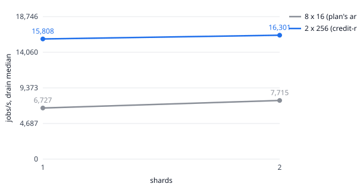

# Sharding

Phase 1 found one PostgreSQL's commit flush to be the ceiling: more brokers
cost throughput (`docs/scaling.md`). Phase 4 splits jobs across N independent
PostgreSQL databases, called shards, behind the existing `store.Store`
interface. This report covers what was built, what was measured, the
decisions taken on the way, and what is left. The design is in
[design/sharding.md](design/sharding.md); the contract changes are in
[semantics.md](semantics.md) §1, §8, §9, §11, §12, §13 and §15.

Every number here comes from a file named next to it. Files under
`docs/` are in the tree. Files under `.plan-runs/` are the plan runner's
local evidence and are not committed (`.git/info/exclude`). The GKE numbers
come from [sharding/gke/results.md](sharding/gke/results.md), which was
written from a hand-run sitting whose raw files are not in the tree (below).

## Results at a glance

| What | Result | Evidence |
|---|---|---|
| One shard down, the other keeps serving | pass, 4 of 4 runs | `docs/sharding/shard-down/` |
| Chaos suite, unsharded / sharded | 9 of 9 / 10 of 10 tests pass | `.plan-runs/phase-4-evidence/p4-gate-chaos.txt`, `task-16/p4-sharded-chaos.txt` |
| Conformance, Go, Java and the mixed fleet, unsharded and sharded | pass in all four passes | `.plan-runs/phase-4-evidence/p4-gate-conformance*.txt`, `task-16/p4-sharded-conformance*.txt` |
| Laptop drain, one shard against two | 1.15× and 1.03×, no measurable effect | `docs/bench/4/` |
| GKE drain, 1 → 4 shards | 3.6× (13.1k → 47.0k jobs/s) | `docs/sharding/gke/results.md` (raw files not committed) |
| GKE soak, 4 shards, faults injected | 10M jobs, 0 lost, 0 unexplained | `docs/sharding/gke/results.md` (raw files not committed) |
| kind soak, 2 shards, 15 min | 192,509 jobs, 0 lost, 0 unexplained | `docs/sharding/soak-kind/soak-20261126T041519/` |
| kind shard failover, 5 min | promoted after 18.6 s; 58,241 jobs, 0 lost, 0 unexplained | `docs/sharding/soak-kind/soak-20261126T043447/` |

## What was built

Branch `phase-4-sharding`, from `main` at `cf3f370`.

- **The shard is in the job's ID.** Byte 9 of the UUIDv7 that
  `postgres.Store.Enqueue` generates holds the shard index (`store.ShardOf`).
  Ack, Nack, Heartbeat, Cancel, GetJob, Redrive and Purge route from the ID
  alone, so the wire protocol, both SDKs and `hopperctl` are unchanged. A
  single-database deployment never stamps IDs (`44620eb`, `0275d25`).
- **`internal/store/sharded`** implements `store.Store` over N
  `postgres.Store`s and holds no SQL. It only chooses a shard: a keyed enqueue
  goes to `fnv1a64(queue, 0x00, key) mod N`, an unkeyed one to the next
  healthy shard in rotation, a lease starts at a rotating shard and asks each
  shard only for what it still lacks, and cron, the leader lock and the clock
  live on shard 0 (`81e12a2`, `bddfc95`, `220563b`, `05e7a87`). The
  rotations are kept per kind of call (`e0840d4`).
- **"Not sent" against "maybe sent".** `store.ErrNotSent` marks a failure
  that certainly happened before the statement was sent: a failed connection
  attempt, the batch acquire bound, or an error pgconn says is safe to retry
  (`0275d25`). Only that moves an unkeyed enqueue to another shard.
- **Shard health.** A shard is down for 1 s after any `ErrUnavailable` from
  it, and a prober on its own session pings each shard every 500 ms. Health
  steers the unkeyed rotation, the shards a lease visits and where an
  announcement goes; it never blocks a call that has to go to one shard
  (`2d1d1c9`).
- **The broker** builds one confirmation batcher per shard, so a dead shard
  can't hold up another shard's acks, and runs each shard's part of an
  `EnqueueBatch` concurrently (`524bb72`). Depth metrics gained a `shard`
  label, and every depth query became max across brokers, then sum across
  shards (`49b0414`).
- **`cmd/broker -shard-dsns`** (`HOPPER_SHARD_DSNS`) takes 2 to 256
  space-separated `postgres://` URLs in shard order and refuses `-dsn` beside
  it. It migrates every shard, then refuses to start if a database's recorded
  shard identity (`shard_identity`) or migration set disagrees with its
  configuration. `-db-max-conns` applies to each shard's pool (`34f5052`).
- **The chart's `postgres.shards`** (1 to 16) renders N bundled databases or
  N CloudNativePG Clusters, `<release>-db-<i>`. One shard renders byte for
  byte what the chart rendered before (`326519a`).
- **Harnesses.** `HOPPER_CHAOS_SHARDS=2` runs the chaos and conformance
  stacks over two shards (`212bb87`, `12a0b92`); `TestOneShardDownServesTheRest`
  (`69b4689`); `scripts/bench.sh` takes `SHARDS` (`4ee25e4`, `e600317`,
  `64ac8a9`); and `TestSoak` (`test/k8s`) offers jobs open loop while it kills
  workers, restarts brokers and fails one shard over, then reconciles every
  chunk of the run (`70d3665`, `63f1639`, `85bf556`, `d78ac4b`).

## One shard down

`TestOneShardDownServesTheRest` (`test/chaos/shard_test.go`) runs two shards,
two brokers and three workers with a backlog of 1,000 jobs on each shard,
stops shard 1 for 30 s, and samples three kinds of enqueue for 25 s of it. It
passed in 4 of 4 runs at `69b4689` (2026-11-26 UTC). Each run's `outage.json`
and `report.json` are in `docs/sharding/shard-down/shard-down-*/`, with every
container's log.

| | Result, 4 runs |
|---|---|
| Keyed enqueues to shard 0 | 251 of 251 succeeded each run; p99 13.1–15.8 ms |
| Keyed enqueues to shard 1 | 251 of 251 failed `UNAVAILABLE` each run; the slowest answer took 18.9–22.9 ms |
| Unkeyed enqueues | 251 of 251 succeeded each run (100%), every one on shard 0 |
| Shard 0's completions during the outage | rose by 1,307–1,327 |
| Jobs | 2,251 of 2,251 completed each run |
| Repeated starts | 6, 7, 5 and 8, every one `lost`: a lease on shard 1 whose ack met the outage and expired (30 s lease) |
| First shard-1 completion after the restart | 0.61–0.73 s |

So a down shard costs the keyed enqueues and the jobs that belong to it, for
as long as it is down, and nothing else: no job was lost, every repeat was
explained, and the other shard kept enqueuing and completing.

Reproduce (each of the four runs was one invocation):

```bash
HOPPER_CHAOS_DIR=$PWD/docs/sharding/shard-down \
  go test -tags chaos -count=1 -timeout 30m -v -run TestOneShardDownServesTheRest ./test/chaos
```

## Chaos and conformance, sharded and unsharded

Tasks 3, 5–9 and 11 touched the delivery path, so the old gates ran first on
one database (Task 13), then on two shards (Task 16).

| Gate | Unsharded | Sharded (`HOPPER_CHAOS_SHARDS=2`) |
|---|---|---|
| Race suite, `scripts/ci.sh go-checks` | pass at `ade5eae` (`p4-gate-unit.txt`, `p4-gate-gochecks.txt`) | n/a |
| Chaos suite | 9 of 9 tests, 595.4 s, at `ade5eae` (`p4-gate-chaos.txt`) | 10 of 10 tests (the shard-down test included), 644.9 s, at `12a0b92` (`task-16/p4-sharded-chaos.txt`) |
| Conformance, Go pass | pass, 299.4 s, at `ade5eae` (`p4-gate-conformance.txt`) | pass, 318.5 s, at `4ee25e4` (`task-16/p4-sharded-conformance.txt`) |
| Conformance, Java pass and the mixed fleet | pass, 348.2 s, at `d78ac4b` (`p4-gate-conformance-java.txt`) | pass, 342.8 s, at `d78ac4b` (`task-16/p4-sharded-conformance-java.txt`) |

The files are under `.plan-runs/phase-4-evidence/`. Counts from the two chaos
passes, unsharded then sharded:
- the 40 s PostgreSQL outage repeated 12 and 9 jobs, all `lost`;
- the worker kills (9 each) repeated 32 and 34, all `killed`;
- a graceful PostgreSQL restart answered 47 and 41 `Ack`s `UNAVAILABLE`, and
  a crash 48 and 28, with no `INTERNAL` in either;
- the storm left one row per key: 1,000 of 1,000, and 999 of 999.

In the sharded pass the tests that stop "PostgreSQL" stop shard 0, and their
gated jobs are on shard 0 (Decisions, Task 16). The sharded pass's run of the
shard-down test answered shard 1's keyed enqueues in at most 23.9 ms.

Reproduce:

```bash
go test -tags chaos -count=1 -timeout 60m -v ./test/chaos
HOPPER_CHAOS_SHARDS=2 go test -tags chaos -count=1 -timeout 60m -v ./test/chaos
bash scripts/conformance.sh all
HOPPER_CHAOS_SHARDS=2 bash scripts/conformance.sh all
```

## Laptop: one shard against two



*Both shards share the laptop's one virtual disk, each on its own CPU. Five-run
medians from one interleaved loop.*

Ref `64ac8a9`, 2026-11-26 02:53–03:08 UTC, on AC power. Two brokers, Go
workers, `PIN=1` (PostgreSQL shard 0 on CPU 0, shard 1 on CPU 1), 40,000
jobs of 300 B per drain, two layouts, five runs per configuration
([bench/4/summary.md](bench/4/summary.md), [medians.txt](bench/4/medians.txt),
[decision.txt](bench/4/decision.txt)).

| Layout | 1 shard, jobs/s (range) | 2 shards, jobs/s (range) | Ratio | Commits/job | WAL syncs/job |
|---|---|---|---:|---|---|
| 8 workers × 16 (the plan's) | 6,727 (6,209–7,277) | 7,715 (6,700–8,120) | 1.15× | 0.34 → 0.44 | 0.068 → 0.145 |
| 2 workers × 256 (credit-rich) | 15,808 (12,583–17,538) | 16,301 (13,442–16,709) | 1.03× | 0.12 → 0.14 | 0.045 → 0.083 |

**The prediction failed.** It was 1.6–2.0× ([bench/4/prediction.md](bench/4/prediction.md),
committed in `4ee25e4` before the loop). Both ratios are "no measurable
effect" by the evidence rule: the ranges overlap.

- Neither CPU was the ceiling. The brokers used 31–37% of 180, and
  PostgreSQL 22–39% of 90 per shard at two shards.
- `LWLock:WALWrite` was the largest wait in every configuration, followed by
  `IO:WALSync`.
- One confirmation batcher per shard halved the ack batches (9.2 → 4.8 and
  15.0 → 10.3), so commits per job rose 29% and 17%, and WAL syncs per job
  about doubled.

The hypothesis: a closed-loop drain on one disk is bound by how long a commit
waits for its flush, times a fixed number of jobs in flight. Splitting those
jobs over two shards halves each shard's group commit and doesn't shorten the
wait. The laptop didn't test it. GKE, with each shard on its own disk and
node, gave 3.6× for four shards (below), which supports it.

Reproduce with `bash docs/bench/4/loop.sh` (about 16 minutes).

## GKE: shard scaling

**Source:** [sharding/gke/results.md](sharding/gke/results.md). The Task 20
sitting was run and reduced by hand, outside this repo's tooling, and its date
isn't recorded. Its raw files are not in the tree: `scaling.csv`, the soak
directory, `scripts/gke-soak.sh` and `deploy/gke/soak-values.yaml`. The
numbers below are as reported from that sitting, and none can be re-derived
from the tree. The cost was not published. The drain and capacity numbers come
from a later run than the soak; its date and raw files aren't recorded here.
The 1 → 4 targets are the improvement plan's.

Each shard was a CloudNativePG Cluster with one synchronous standby, on pd-ssd.
Throughput is the median of 3 drains of 1,000,000 jobs of 300 B.

| | Result | Against the targets |
|---|---|---|
| 1 shard | 13.1k jobs/s | |
| 1 → 4 shards | 3.6×, 47.0k jobs/s | "great" (3.5×+) |
| Spread of the 3 drains, (max − min) ÷ median | 19% | |
| Capacity at 4 shards, as a share of the drain | 71% (about 33.4k jobs/s) | |
| Enqueue p99 at capacity | 18 ms | under the 25 ms bar |
| 30-minute pre-soak | kept up at 68% of capacity | |

- **1 → 4 shards gave 90% of linear.** No 2-shard drain is recorded, so
  where the shortfall appears isn't known.
- **One GKE shard is slower than the laptop's best single shard**, 13.1k
  against 15.8k jobs/s. That is consistent with every commit waiting for a
  synchronous standby and for pd-ssd's network flush.
- **The worker layout used on GKE is not recorded.**

**Reproduce:** the scaling drains' script (`scripts/gke-soak.sh`) is not
committed, so the drains can't be rerun from the tree.

## GKE: the soak

**Source:** [sharding/gke/results.md](sharding/gke/results.md), as above: as
reported, with no raw files in the tree. Four shards; a worker kill every 3
minutes, a broker restart every 15 minutes, and one failover of shard 1 at
the halfway mark.

| | Result |
|---|---|
| Jobs | 10M |
| Lost | 0 |
| Unexplained repeats | 0 |
| Redelivery rate | 1e-4 |
| Completed rate against offered | within 0.9% |
| Shard failover: promotion | 26 s |
| Shard failover: back to the offered rate | 3 min |
| Pickup p99 | 140 ms |
| Per-shard table size | levelled off at 42 min |
| `n_dead_tup` per shard, soak enqueue p99 | not reported |

Recovery after the failover was the one miss against the bands (under 2
minutes was "good"). The soak ran near 70% of capacity, and only one shard in
four was down, so a 3-minute return points to something slow after the
promotion, not to the backlog. `results.md` names the candidates: a cold
cache on the new primary, broker pools reconnecting with backoff, or the
replacement standby catching up while synchronous commits wait for it. The
shard-1 rows of the soak's `timeline.csv` would tell them apart, and that
file isn't in the tree.

Reproduce. The soak's command is in the tree. Its rate and duration come from
the pre-soak, and the release comes from the uncommitted values file:

```bash
HOPPER_K8S_CONTEXT=<gke> HOPPER_SOAK_KILL=crictl-debug HOPPER_SOAK_RATE=<r> \
HOPPER_SOAK_DURATION=<d> HOPPER_PROOF_DIR=$PWD/docs/sharding/gke/soak \
  go test -tags k8s -count=1 -timeout <d+1h> -run TestSoak -v ./test/k8s
```

## kind: the soak harness, rehearsed

`TestSoak` was rehearsed on kind with two shards before GKE. Each run's
`summary.md`, `report.json`, `timeline.csv`, `events.csv` and SVGs are in
`docs/sharding/soak-kind/`. The worker logs and the lists of acknowledged
IDs stay local (Decisions, Task 21).

| Run | Ref | Mode | Jobs | Lost | Unexplained | Redelivery | Enqueue p99 | Note |
|---|---|---|---:|---:|---:|---:|---:|---|
| `soak-20261126T033539` | `70d3665` | bundled | 184,292 | 0 | 0 | 0.000049 | 17.5 ms | `Parse`; peak RSS 348 MiB |
| `soak-20261126T035404` | `63f1639` | bundled | 187,403 | 0 | **1** | 0.000117 | 15.1 ms | failed: a log capture gap at a kubelet rotation (Decisions, Task 19) |
| `soak-20261126T041519` | `85bf556` | bundled | 192,509 | 0 | 0 | 0.000031 | 44.1 ms | `ParseFiltered`; peak RSS 457 MiB |
| `soak-20261126T043447` | `d78ac4b` | cloudnativepg | 58,241 | 0 | 0 | 0.000155 | 865.2 ms | shard 1's primary crashed at 150 s; promoted after 18.6 s |

The 15-minute runs offered 200 jobs/s with 5 worker kills and 3 broker
restarts each, and completed 200.0 a second on average. In the failover
rehearsal, 4,426 of 62,835 offered calls could not start on time: their slots
were held by retries to the dead shard. 208 retries were answered
deduplicated, and 2,627 calls failed `DEADLINE_EXCEEDED` and 351
`UNAVAILABLE`. Those calls account for the enqueue p99. Every job was still
reconciled.

Reproduce:

```bash
scripts/kind-up.sh -f deploy/kind/shards.yaml
HOPPER_SOAK_DURATION=15m HOPPER_SOAK_CHUNK=100000 HOPPER_SOAK_BROKER_RESTART_EVERY=5m \
HOPPER_PROOF_DIR=$PWD/docs/sharding/soak-kind \
  go test -tags k8s -count=1 -timeout 60m -v -run TestSoak ./test/k8s

# The failover rehearsal: two CloudNativePG Clusters, five minutes.
scripts/kind-cnpg.sh
scripts/kind-up.sh -f deploy/kind/shards.yaml --set postgres.mode=cloudnativepg --timeout 10m
HOPPER_SOAK_DURATION=5m HOPPER_SOAK_CHUNK=100000 HOPPER_SOAK_BROKER_RESTART_EVERY=5m \
HOPPER_SOAK_KILL=crictl-debug HOPPER_PROOF_DIR=$PWD/docs/sharding/soak-kind \
  go test -tags k8s -count=1 -timeout 60m -v -run TestSoak ./test/k8s
```

## Deviations from the improvement plan

- **The shard is in the ID, not a wire field.** A `shard` field would have to
  be carried by every caller that names a job. Byte 9 of the UUIDv7 was
  random, and the ID already travels everywhere ([design](design/sharding.md),
  "Alternatives considered").
- **pd-ssd instead of local SSD on GKE.** CloudNativePG on local SSD needs a
  local-volume provisioner, which is a project of its own.
- **The open-loop producer was pulled forward from the deferred list.** The
  soak needs an offered rate that doesn't slow down when hopper does.
  `TestSoak` counts a call that can't start on time as behind and doesn't
  queue it.
- **The leadership call is `TryLeadership(ctx, ttl)`.** The plan's code
  wrote `TryLeadership(ctx)`. The silent-leader work on `main` added the TTL
  before this branch began, and `sharded.Store` passes it through to shard 0.

## Decisions

- **Task 10: `TestDashboardQueryShape` got stricter.** It now requires
  `and on (job, instance, shard)` and a `max by (... shard)` in every depth
  query. Why: depth is max across brokers, then sum across shards. A query
  that dropped `shard` from either step would add one shard's depth to
  another's, or take the max across shards, and the old test would still
  pass.
- **Task 12: the end-to-end test gives each broker its own sharded store.**
  Why: two brokers sharing one `sharded.Store` value would share its routing
  state, and real brokers don't. Doing it this way exposed a rotation bug:
  announcements and lease polls advanced the same rotation as unkeyed
  enqueues and pinned those enqueues to one shard. `e0840d4` fixed it with a
  rotation for each kind of call.
- **Task 14: `postgres-1`'s healthcheck timeout is 3 s.** Why: that is the
  base `postgres` service's timeout in `docker-compose.yml`. The two shards
  are configured alike, so they differ only in their data.
- **Task 15: the unkeyed-enqueue rate while one shard is down.** I took the
  recommended bar: at least 90% of unkeyed enqueues succeed, and every
  failure is `UNAVAILABLE`. It measured 100% in 4 runs.
- **Task 16: gated jobs live on shard 0.** The outage tests stop shard 0, and
  each claims something of every gated job:
  - `TestPostgresRestartLosesNoAck`: the job's Ack met the outage;
  - `TestAnOutageLongerThanTheLeaseReexecutes`: the job ran again;
  - `TestConformanceShortPostgresOutage`: the job's Ack was retried inside
    its lease.

  With two shards, the gated keys were spread across both by
  `store.KeyShard`, and a gated job on shard 1 never meets the outage. The
  assertion assumed one database. Per the plan's recommendation the claim is
  now judged on shard 0's jobs. `stack.gate` picks keys that route to shard 0,
  so the claim stays as strong as it was: all six gated jobs, every one on
  the stopped database. With one database every key is shard 0's, and the
  keys are unchanged. No loss or accounting check changed. Commit `12a0b92`.
- **Task 16 (harness fix, not a relaxation):** the conformance helpers read
  shard 0 only: `rows` (what the judges read), `startedJobs` and
  `awaitLeased`. They now read every shard (`queryAll`), and `awaitLeased`
  routes its by-id lookup with `store.ShardOf`. Commit `12a0b92`.
- **Task 17: a second, credit-rich arm.** The loop runs the plan's arm
  exactly (2 brokers, 8 workers × 16, `PIN=1`, `SHARDS` 1 and 2, five runs
  each). It also runs 2 workers × 256 with everything else the same,
  interleaved in the same loop. Why: H6 (`docs/scaling.md`) found 8 × 16
  credit-starved, at 0.47× of one broker's best (11,348 jobs/s against
  24,330 at 2 × 256). H6's follow-up asks that shard baselines also be
  measured at a credit-rich layout, so that a shard ratio isn't one starved
  layout's number.
- **Task 17: `PIN=1` gives PostgreSQL one CPU per shard, at every shard
  count.** `postgres` now runs on CPU 0 alone, even with `SHARDS=1`, and
  `postgres-1` runs on CPU 1. This is the plan's layout, so one shard and two
  compare like with like. Earlier `PIN=1` rows had PostgreSQL on CPUs 0-1.
  Their `harness` column differs, so the summary never pools them with new
  rows. The summary now calls PostgreSQL saturated at 90 per shard, and keeps
  180 for rows without a `shards` column.
- **Task 17: `WARM_JOBS` needs `SHARDS=1`.** The warm pace ranks
  completions across every shard. Nothing in this phase needs it sharded, so
  `scripts/bench.sh` refuses the combination rather than carry an untested
  path.
- **Task 17: the first loop was discarded.** Four runs in, the laptop's load
  average was 14 on 8 CPUs. Five `scripts/bench.sh` processes left over from
  timed-out harness tests were still spinning their samplers, and those whose
  temporary directory was gone were calling the real `docker`. Enqueue rates
  in the loop rose about fivefold the moment they were killed. One of the
  four runs (w8c16, two shards) had failed with `broker-standby` exiting
  during startup, and its logs were lost to a cleanup bug. That startup
  failure did not recur in four clean two-shard starts, and the leftovers are
  the likely cause, though that wasn't proven. The harness was fixed (tests
  kill a timed-out run's whole process group; cleanup keeps logs and tears
  down even when startup fails, `64ac8a9`), and the loop was rerun from
  scratch. The aborted loop's rows and evidence are kept in
  `.plan-runs/phase-4-evidence/task-17/aborted-loop-1/` and are not results.
- **Task 17: tools for the shard comparison.** `bench_compare.py --column
  shards` picks control and treatment by the shard count within one variant,
  and `bench_chart.py --x shards` draws throughput against the shard count.
  The summary treats `shards` as part of the setup, so one shard and two never
  pool. It adds a shard verdict for setups that differ only in `shards`.
- **Task 18: one shard renders byte for byte what the chart rendered
  before.** The fixtures in `test/chart/testdata/shards-1/` are renders of
  `64ac8a9`'s chart (bundled, CloudNativePG, kind autoscaling, the failover
  values), not `main`'s: `main` predates Task 10's shard-labelled depth query,
  so a render of `main` could never match. To keep that promise, the brokers'
  init container keeps its old `pg_isready -d "$HOPPER_DSN"` command for one
  shard, and uses the plan's `for d in $HOPPER_DSN $HOPPER_SHARD_DSNS` loop
  for more. Bundled shards get one headless Service per pod,
  `<release>-postgres-<i>`, selecting `statefulset.kubernetes.io/pod-name`;
  the StatefulSet's governing Service `<release>-postgres` stays.
- **Task 19: the soak's log capture follows a worker across restarts.** A
  SIGKILLed worker container is restarted in place, in the same pod. The
  existing capture stops following a pod once its container exits, and a
  re-attach rewrites the file. Either way, what the killed or the restarted
  container logged would be lost. `startRestartCapture` (`cluster_test.go`)
  appends each attach's new lines, deduplicated by timestamp within a
  5-second window, and follows a pod until it is gone. The other proofs keep
  the old capture.
- **Task 19: kind's kubelet keeps a container's log in one file up to 1Gi**
  (`deploy/kind/cluster.yaml`). The second 15-minute rehearsal failed with one
  job "completed, but no worker logged its start". That worker's capture was
  missing about 50 ms of lines (04:01:16.55–.60). The gap fell on a kubelet
  rotation tick: every rotation that run fell at :x6 s, and that worker
  rotated its 10Mi log about every 90 s. The job ran once (attempts 1, and its
  handler-finished and ack lines are there). A 100-second follow of a
  synthetic logger across five rotations lost nothing, so the race is
  intermittent, but rotation was the only event at that moment. The rehearsal
  that followed, with 1Gi logs, passed. `TestSoak` now refuses to start when a
  worker's kubelet would rotate mid-run (`HOPPER_SOAK_LOG_CHECK=off` overrides).
  The failed run's evidence is kept in `soak-kind/soak-20261126T035404`.
  **For Task 20:** GKE's default is also 10Mi, so raise `containerLogMaxSize`
  in the worker pool's node system config before the soak.
- **Task 19 Decision (accounting memory): `accounting.ParseFiltered` added.**
  Measured on kind (2 shards, 200 jobs/s, 15 min, chunks of 100,000):
  - With `Parse` (`70d3665`, 184,292 jobs, 151 MiB of worker logs), peak RSS
    was 348 MiB (`/usr/bin/time -l`: 364,740,608 bytes). Of that, 306 MiB
    came before the logs were parsed.
  - Taken literally (one 100,000-job chunk peaked at 339 MiB, ×10), a
    1,000,000-job chunk extrapolates to about 3.3 GB, under the 4 GB bar.
  - But `Parse` holds every chunk's lines at once. At GKE's 10M jobs that is
    about 8 GiB of log text (~880 bytes a job), and by the same ratio about
    18 GB of RSS, well over 4 GB.

  So I took the recommended option. `ParseFiltered(pod, r, keep)` keeps the
  kept jobs' lines and every line about no job. It holds each run of dropped
  lines as one line carrying the run's last time, because a process's last
  line decides whether a kill explains a repeat. A test shows a naive filter
  changes that verdict, and that this one reconciles exactly as `Parse` does.
  With it (`85bf556`, 192,509 jobs, 154 MiB of logs), reconciling each chunk
  didn't raise the peak (457 MiB, all of it from before reconciliation). That
  earlier peak came mostly from the end-of-run `snapshot`, which holds whole
  logs. `d78ac4b` replaced it with a streaming append.
- **Task 19 Decision (failover rehearsal): attempted, and it ran.**
  `postgres.mode=cloudnativepg` with `shards=2` scheduled all six instances
  at 128Mi requests in kind's 3.8 GiB Docker VM (2.0 GiB in use). The 5-minute
  rehearsal (`d78ac4b`, `HOPPER_SOAK_KILL=crictl-debug`) crashed shard 1's
  primary at 150 s. `hopper-db-1-2` was promoted after 18.6 s, and the Cluster
  was healthy after 31 s. It also ran a worker kill and a broker restart.
  Result: 58,241 jobs, 0 lost, 0 unexplained. 4,426 offered calls were behind
  (slots held by retries to the dead shard), and 208 retries were answered
  deduplicated. This also tested Task 20's kill path (`kubectl debug node/…
  --profile=sysadmin`) on kind.
- **Task 21: the GKE sections cite `docs/sharding/gke/results.md`, as
  reported.** Task 20 was run by hand, outside this repo's tooling, and only
  its write-up reached the tree. `scaling.csv`, the soak directory,
  `scripts/gke-soak.sh` and `deploy/gke/soak-values.yaml` did not. Rather than
  leave the GKE sections "pending", this report, `semantics.md` §15 and the
  README quote the numbers from `results.md` and say each time that they were
  reported from a sitting whose raw files aren't committed. Why: the numbers
  are the phase's main result, and hiding them would be less honest than
  quoting them with their provenance. The soak's command is in the tree and is
  given. The scaling drains' script isn't, so no command is given for them.
  The cost was withheld, and nothing here estimates it.
- **Task 21: a soak's worker logs and its lists of acknowledged IDs are not
  committed.** `.gitignore` gains `docs/sharding/**/logs/` and
  `docs/sharding/**/acked-*.txt`. A kind run's logs are about 150 MB and its
  `acked-*.txt` files about 11 MB (up to 5.9 MB each). The lists are only
  useful together with the logs, as inputs to a fresh reconciliation. What
  is committed per run is `summary.md`, `report.json`, `timeline.csv`,
  `events.csv`, `problems-*.json` where there is one, and the SVGs, about
  10.8 MB with the shard-down runs. The shard-down runs keep their container
  logs (under 1 MB each), because they are the whole input to that test's
  reconciliation. The ignored files stay in the working tree.
- **Task 21: the failed kind soak is kept.** `soak-kind/soak-20261126T035404`
  (`63f1639`) has 1 unexplained job, because the worker log capture lost about
  50 ms at a kubelet log rotation (Task 19 above). That was a harness
  failure, not a product failure: the job ran once (attempts 1), and its
  handler-finished and ack lines are in the log. It is the evidence for that finding and for the log-size check
  `TestSoak` now makes, so it stays, with a `NOTE.txt` in the directory.
- **Task 21: §12's silent-leader wording.** The plan said to add, to §12's
  silent-leader item, that cron now depends on shard 0 alone. That item is
  gone: the silent leader was fixed on `main` (`cf3f370`, §13 "A silent
  leader") before this branch began. §12 instead gains "Cron on more than one
  database", which says cron, the leader lock and the clock rest on shard 0
  alone: a silent leader still loses the role within the TTL, but a shard-0
  outage stops cron until shard 0 is back.
- **Task 21: four shard-down runs, reported as 4 of 4.** The plan asks for 3
  in a row. Task 15 ran it four times, and all four are reported.

## What's left

- **Commit Task 20's raw files.** `scaling.csv`, `docs/sharding/gke/soak/`
  (`summary.md`, `report.json`, `timeline.csv`, `events.csv`),
  `scripts/gke-soak.sh` and `deploy/gke/soak-values.yaml`. Until they are in
  the tree, no GKE number can be re-derived from it, and the scaling drains
  can't be rerun. Record the GKE worker layout and the sitting's date with
  them.
- **Confirm the GKE cluster and its disks are gone.** `results.md` doesn't
  record it. `gcloud container clusters list` and `gcloud compute disks list`
  must both be empty.
- **Why recovery after a shard failover took 3 minutes** (promotion took 26
  s). The shard-1 rows of the soak's `timeline.csv` would distinguish a cold
  cache from slow pool reconnects or a catching-up standby.
- **What binds at 4 shards.** 1 → 4 shards gave 90% of linear. Find whether
  the shortfall is the brokers, the worker slots or the load generator before trying 8.
- **Not measured on GKE:** `n_dead_tup` per shard, the soak's enqueue p99,
  and whether the pre-soak timeline stayed flat.
- **The laptop hypothesis is untested on the laptop.** Rerun
  `docs/bench/4/loop.sh` with more jobs in flight (more slots, or `WORK_MS`),
  or with one disk per shard.
- **The autoscaling proofs assume one depth timestamp series per broker.**
  `brokerAges` (`test/k8s/autoscale_test.go`) returns one value per series,
  and `TestUnknownDepthHoldsTheFallback` expects as many values as brokers.
  With the sharded chart each broker exports one series per shard, so that
  check fails on a sharded release. With one shard every broker exports one
  series (`shard="0"`), as before. Neither proof has been run sharded.
- **Resharding** is not supported. N is fixed for a deployment's life, and
  `shard_identity` enforces it (§12).
- **Cron rests on shard 0** (§12, §13).
- **Local SSD on GKE** needs a local-volume provisioner for CloudNativePG.
